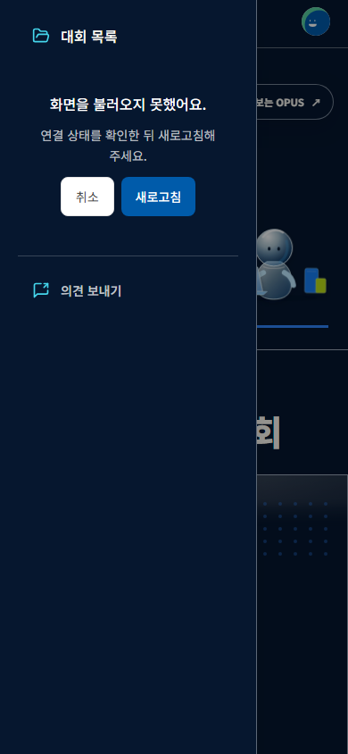
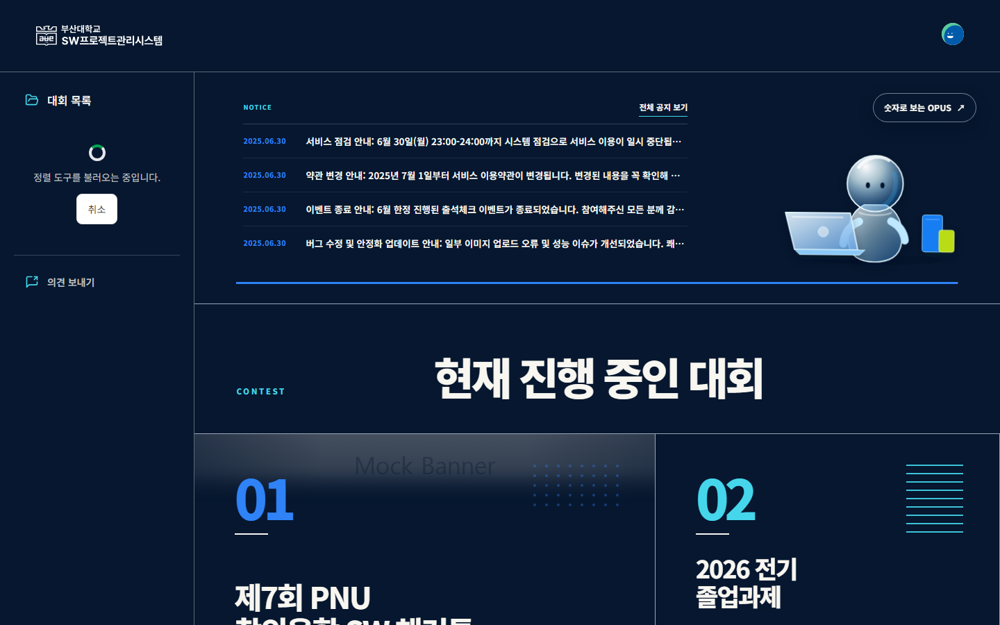

# 초기 JavaScript 로딩 분리 — #329

## 문제와 분석

홈만 방문해도 AppRoutes의 정적 import를 통해 관리자·마이페이지·프로젝트 편집 코드까지 내려받았다. 공개 Sidebar의 정적 SidebarSortEditor import는 관리자 정렬에만 필요한 dnd-kit도 초기 그래프에 연결했다. Calendar는 관리자 설정 페이지에서 사용한다. 설치되어 있지만 src에서 사용하지 않는 Recharts는 원인에서 제외했다.

기준은 develop `0fd079e8687c3026c8494fe0c86ffcb6c6962522`다. 기능 변경과 분리한 독립 브랜치에서 먼저 기준 빌드를 보관하고, 라우트만 분리한 중간 빌드와 정렬 도구까지 분리한 최종 빌드를 비교했다. Vite의 큰 청크 경고 기준은 변경하지 않았다.

## 설계와 구현

- MainPage와 레이아웃·권한 가드는 즉시 로드한다. 나머지 32개 페이지는 모듈 최상위에서 선언한 React.lazy로 필요한 경로에서 가져온다. 기존 경로·URL 파라미터·리다이렉트·라우터 생성 방식은 유지한다.
- SidebarSortEditor는 관리자가 정렬을 열 때 로드한다. 로딩 중 취소할 수 있고 취소/저장 후 정렬 버튼으로 포커스를 돌린다. 모듈이 이미 로드된 경우 다시 요청하지 않는다.
- DeferredContent가 코드 로딩과 실패 UI만 공통화한다. 기존 QueryWrapper의 QueryErrorResetBoundary는 API 조회 재시도에 필요한 경계이므로 그대로 둔다. lazy가 캐시한 실패 promise는 query reset으로 해결되지 않아 사용자가 현재 URL을 새로고침하도록 안내한다. 자동 새로고침 반복은 없다.
- 화면 전체에 Suspense를 두지 않고 페이지 또는 정렬 편집 영역 안에 둔다. 지연/실패 중에도 헤더와 바깥 탐색 영역을 사용할 수 있다. 기존 Spinner, mainBlue, 흰 페이지와 홈의 editorial 톤을 사용했다.
- 새 의존성·수동 vendor chunk 규칙·선행 다운로드·Query 캐시 변경은 추가하지 않았다. 첫 방문 비용을 실제 필요한 화면으로 옮기는 범위에 한정했다.

[React.lazy](https://react.dev/reference/react/lazy)의 모듈 최상위 선언·promise 캐시·ErrorBoundary 동작과 [Suspense](https://react.dev/reference/react/Suspense)를 근거로 선택했다. 설치된 React 19.1.0에서 사용 가능한 API만 사용한다.

## 측정 조건

Windows 로컬, Node 22.13.1, Vite 6.4.1, React 19.1.0, react-router-dom 7.13.1, Chromium 140.0.7339.16. 동일 lockfile SHA256: `2DA5A3A48A1EBA811466EB20AF6A534F7C139CEE7BBCDE9E6519D2F9523F3C53`.

Vite production build를 localhost preview에서 실행했다. 각 단계에서 홈·로그인·관리자 홈→관리자 대시보드를 각 5회, 매번 새 context/HTTP cache 비활성화로 측정했다. 1440×900, CPU 4배 제한, latency 50ms, 송수신 1,250,000bytes/s, reduced motion을 동일하게 적용했다. 빌드나 다른 브라우저 검증을 측정과 동시에 실행하지 않았다.

API는 기존 MSW의 합성 응답을 수집하여 Playwright route로 재생했다. 관리자 `/categories`와 알림 빈 목록만 명시적인 합성 fixture를 보완했다. Google 한글 폰트도 한 번 수집해 동일 응답을 재생했다. production에는 MSW runtime을 실행하지 않았다. 외부 API/실계정에 접근하지 않았다. 따라서 실제 API 지연, CDN, 사용자 기기, 전체 서비스 성능을 대표하지 않는다.

초기 JS는 실제 ResourceTiming의 `.js` 응답 합계다. preview가 gzip으로 제공한 **encodedBodySize**와 응답당 헤더 추정분을 포함한 **transferSize**를 구분해 원본에 보관했다. 아래 KB는 1,000bytes다. LCP는 PerformanceObserver, 스크립트 시간은 CDP Performance의 ScriptDuration이다. 관리자 이동 시간은 메뉴 클릭 직전부터 대시보드 제목 표시까지다. 모든 단계에서 같은 판정식을 썼다.

## 측정 결과

| 지표 | 기존 | 라우트만 분리 | 라우트 + 정렬 도구 분리 |
|---|---:|---:|---:|
| 엔트리 JS, 비압축 KB | 1,116.01 | 688.66 | 613.18 |
| 홈 초기 JS 응답 본문 KB | 334.928 | 223.090 | 199.562 |
| 홈 초기 JS 요청 수 | 1 | 1 | 1 |
| 로그인 초기 JS 응답 본문 KB | 334.928 | 226.144 | 202.863 |
| 로그인 초기 JS 요청 수 | 1 | 7 | 8 |
| 관리자 첫 이동 추가 JS 본문 KB | 0 | 15.530 | 21.460 |
| 관리자 첫 이동 추가 JS 요청 수 | 0 | 13 | 14 |

홈 초기 JS 본문은 135,366bytes(40.4%), 로그인은 132,065bytes(39.4%) 감소했다. 라우트 분리 후에도 남아 있던 정렬 도구를 지연시켜 홈에서 추가로 23,528bytes를 제외했다. 최종 홈의 실제 초기 요청은 엔트리 하나이며, Calendar·SidebarSortEditor·sortable·AdminDashBoardPage 청크가 포함되지 않는다. 정렬 첫 클릭에서 SidebarSortEditor를 가져오는 것을 별도로 확인했다.

시간 단위는 ms, 표기 방식은 **중앙값 [최소–최대]**, 각 5회다.

| 지표 | 기존 | 라우트만 분리 | 최종 |
|---|---:|---:|---:|
| 홈 스크립트 실행 | 723 [627–827] | 463 [432–573] | 367 [351–621] |
| 홈 LCP | 1,588 [1,364–2,772] | 992 [968–2,264] | 816 [796–2,240] |
| 로그인 스크립트 실행 | 497 [456–592] | 302 [288–314] | 280 [231–444] |
| 로그인 LCP | 1,252 [1,124–1,488] | 844 [816–876] | 808 [776–968] |
| 관리자 계정의 홈 스크립트 실행 | 933 [733–1,177] | 518 [438–588] | 421 [386–535] |
| 관리자 계정의 홈 LCP | 1,800 [1,528–1,940] | 1,016 [992–1,160] | 924 [912–1,156] |
| 홈→관리자 제목 표시 | 1,189 [891–1,385] | 1,712 [925–2,550] | 1,525 [1,360–2,287] |

시간은 로컬 관측값이다. 단계별 순차 실행이며 무작위 교차 실험이 아니고 첫 실행의 서버/브라우저 준비 비용과 CPU 잡음이 있다. 5개 표본으로 통계적 유의성이나 운영 LCP 개선율을 주장하지 않는다. 결정 근거는 재현 가능한 요청 그래프와 전송량 감소이며 시간의 범위도 함께 남긴다.

원본: [기준 15표본](before-measurements.json), [라우트만 분리 15표본](routes-only-measurements.json), [최종 15표본](after-measurements.json). 실패 목록은 원본에 포함한다.

## 비용과 한계

관리자 첫 이동에는 14개 추가 요청/21.46KB가 필요하고 이 환경의 중앙값은 **약 336ms 증가**했다. 로그인 직접 진입도 8개 요청으로 늘어난다. Vite가 공유 의존성을 병렬 preload하지만 고지연 네트워크에서는 더 불리할 수 있다. 선행 다운로드로 다시 홈 비용을 늘리지 않고 이번 변경에서는 명시적 로딩/복구 UI를 제공한다. 실제 사용 분포가 확보되면 자주 쓰는 경로에 한해 별도 측정 후 판단할 수 있다.

전체 앱 코드를 제거한 작업이 아니며 첫 방문에 필요한 위치로 옮긴 작업이다. 공통 의존성과 홈 코드는 남아 있고 엔트리는 여전히 500KB 경고를 넘는다. Query 요청 감소, 전체 앱 총용량 감소, 운영 응답 속도 개선은 주장하지 않는다.

신규 배포에서 오래된 청크가 사라진 상황은 청크 요청 차단으로 모사했다. 수동 새로고침과 URL 보존은 확인했으나 실제 CDN의 HTML 캐시 정책/롤링 배포는 미검증이다. 엔트리 자체 로드 실패는 React 경계가 실행되기 전이므로 이번 범위에서 복구할 수 없다.

## UI 검토와 회귀 범위

#314는 미병합이므로 해당 checkout의 기존 Playwright·브라우저·네트워크 가드를 재사용했다. 별도 설정을 추가하지 않았다. 기존 OPUS의 실제 홈·인증 화면, Spinner·버튼 토큰과 앞선 조사에서 확인한 Renewal Header(14:90), Button(14:73), TextField(687:3271)를 참고했다. 코드 로딩/실패와 일치하는 최종 Figma node는 발견하지 못했으며 디자인과의 완전 일치는 미검증이다.

1440·768·390에서 페이지 로딩/실패, 홈 정렬 로딩/실패/완료 **15장**을 직접 열어 검토했다. 밝은 페이지는 짧은 안내와 한 개 복구 액션으로 위계를 유지하고, 어두운 사이드바는 흰 본문과 밝은 보조색을 사용한다. 한글 어절, 버튼 높이 44px, 중앙 정렬, 좁은 패널의 두 줄 설명을 확인했다. 새 카드/그림자/장식은 추가하지 않았다. 첫 데스크톱 캡처의 홈 진입 애니메이션 중간 장면은 기존 runner와 동일한 animations disabled 설정으로 재촬영하고 다시 확인했다.

30개 캡처/행동 확인 기록은 [visual-checks.json](visual-checks.json)에 있다. 실패 청크의 수동 복구 및 query/hash 유지, 대기 중 취소와 포커스 복귀, 취소 후 다시 열 때 모듈 요청 1회, 비로그인 관리자/마이페이지의 하위 청크 요청 차단, 인증 페이지 뒤로/앞으로 이동, 404를 확인했다. 기본 API 처리와 권한 가드는 변경하지 않았다. 모든 32개 페이지의 내부 업무 동작, 실인증/OAuth, 실제 스크린리더 음성은 이 검증에 포함하지 않는다. 관리자 기존 최소폭 문제는 #299 범위다.

새로 생긴 상태이므로 기존 화면과 동일한 상태의 Before 이미지는 없다. 아래는 합성 데이터로 캡처한 원본이며 편집하지 않았다.

| 모바일 페이지 실패 | 모바일 정렬 실패 |
|---|---|
|  |  |

## 재현

1. 기존 #314 QA checkout(`545203c`)의 `docs/visual-qa.md` 환경을 준비한다. 아래 조사는 그 checkout의 `.qa/perf-329`에서 실행한다. 새 Playwright 환경은 만들지 않는다.
2. [scripts.md](scripts.md)의 세 코드 블록을 같은 이름의 파일로 저장한다. collector는 4186 포트의 기존 MSW 개발 서버에 연결하므로 기준 develop checkout을 `VITE_USE_MSW=true`, `VITE_API_BASE_URL=''`로 실행한다. `collect-fixtures.cjs`를 실행해 합성 API와 허용된 폰트 응답을 한 번 수집한다. 이후 모든 비교에 같은 fixtures.json/fonts.json을 사용한다.
3. 기준 develop과 이 PR을 동일 lockfile/환경에서 각각 production build하고 dist를 서로 다른 디렉터리에 보관한다. VITE_USE_MSW와 VITE_API_BASE_URL을 비운 상태를 동일하게 사용한다. 기준 snapshot은 preview 4190, 최종 snapshot은 4192에서 제공한다. 중간 routes-only는 Sidebar 변경 전의 탐색 실험이며 원본 수치는 함께 보관했다.
4. 기존 가이드의 PLAYWRIGHT_BROWSERS_PATH를 유지한 뒤 `node .qa/perf-329/measure.cjs before 4190`, `node .qa/perf-329/measure.cjs after 4192`를 순차 실행한다. 빌드/다른 브라우저를 동시에 실행하지 않는다. 매번 15표본과 오류 목록을 JSON으로 저장한다. 이전 원본 파일은 덮어쓰기 전에 별도로 보관한다.
5. `node .qa/perf-329/visual.cjs`는 4192의 실제 청크를 지연/차단하고 동일 가드로 합성 API를 제공한다. 결과 PNG를 직접 검토한다. 실패를 정상 캡처로 취급하거나 지표에서 누락하지 않는다.

스크립트의 QA 선언 재사용은 runner 내부에 의존하는 일회성 조사 방법이다. runner 업데이트 시 split 지점/준비 판정/네트워크 가드를 재확인한다. 배포 제품의 의존성이나 새 테스트 체계가 아니다.
