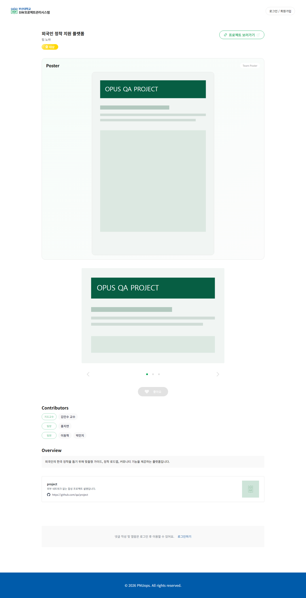
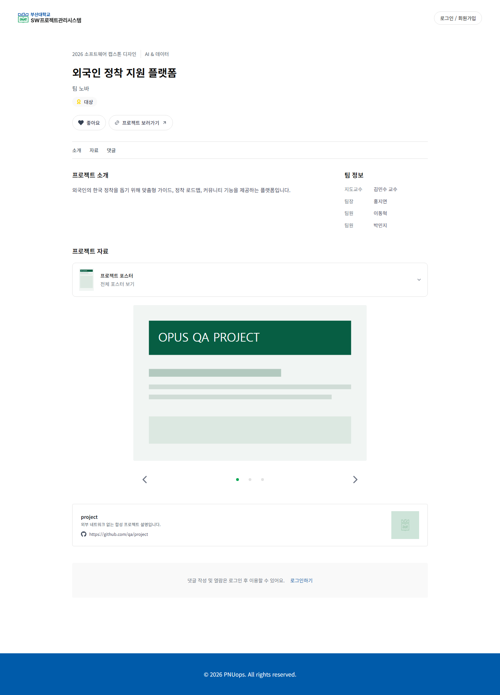
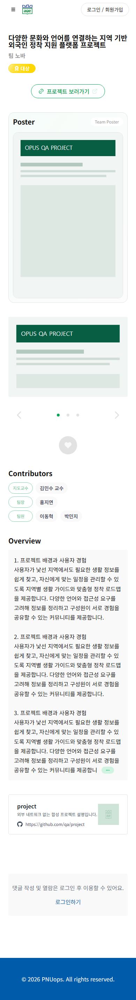
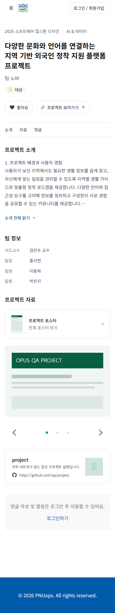

# 프로젝트 상세 콘텐츠 구조 개선 — #297

프로젝트명·대회·팀 맥락과 주요 액션을 먼저 확인하고, 소개를 읽은 뒤 자료와 대화를 탐색하도록 순서를 정리했다. 포스터는 작은 미리보기에서 전체 이미지로 펼칠 수 있으며, 긴 소개도 전체 내용을 유지한 채 단계적으로 읽을 수 있다.

## Before / After

모든 이미지는 로컬 MSW 합성 데이터로 촬영한 원본 PNG다. 실제 사용자 정보·계정·토큰은 포함하지 않는다. 포스터와 이미지도 QA용 합성 SVG이며, 프로젝트 배포 링크와 GitHub 정보는 fixture다. 변경 전 프로젝트 코드는 `develop`의 `0fd079e`를 기준으로 한다.

### Desktop · 1440 × 900 · 짧은 소개

| Before | After |
| --- | --- |
|  |  |

### Mobile · 390 × 844 · 긴 제목과 소개

| Before | After |
| --- | --- |
|  |  |

## 화면 구성과 디자인 근거

- 제목은 `h1`으로 명확히 구분하고 한글 긴 제목의 행간을 확보했다. 기존 응답의 대회명·분과·팀 정보를 제목 주변에 배치했다.
- 좋아요/투표·프로젝트 이동·수정 액션을 상단으로 모았다. 소개·자료·댓글·권한이 있는 피드백은 앵커로 이동하며, 기존 `#awards`, `#comments`, `#feedback`을 유지한다.
- 소개와 팀 정보는 넓은 화면에서 나란히, 모바일에서는 읽는 순서대로 배치했다. 긴 소개는 최대 220자의 미리보기에서 가능한 문단 경계를 우선하고, 이름이 있는 버튼으로 전체 읽기/접기를 제공한다.
- 포스터의 과도한 초기 높이와 중첩 패널을 줄였다. 펼치면 기존 이미지 주소와 원본 비율을 유지한 전체 포스터를 확인할 수 있다. 캐러셀의 이미지·영상 전환도 유지했다.
- 수상 배지는 중립 배경과 진한 글자로 읽기 쉽게 표시하고, 기존 상훈 색상은 아이콘에 유지한다. 공통 `AwardTag`의 다른 사용처는 변경하지 않았다.
- 소개·자료·GitHub가 없는 상태를 실제 빈 상태로 처리한다. 이미지 디코딩 실패 시 무한 로딩 대신 안내하며, 처리 중·실패 메시지의 대비와 키보드 포커스 표시를 보완했다.
- 프로젝트 상세 경로만 `FullContainer`의 화면 전체 최소 높이를 해제한다. `MainLayout`은 해당 경로에서만 남은 화면 높이를 채워 짧은 상태에서도 푸터를 하단에 놓는다. 다른 경로의 기본 레이아웃과 기존 푸터 간격 정책은 유지했다.

설계 근거는 [#297 요구사항](https://github.com/PNUops/opus-frontend/issues/297), 기존 OPUS 프로젝트 상세의 실제 렌더링, 공통 컴포넌트와 `src/index.css`의 색상·간격 토큰이다. [Notion 프로젝트 상세 조회](https://app.notion.com/p/33eb174e8df68041a4a6d1cd783986f9)는 소개·팀원·이미지·성과·상호작용 제공을 설명하지만 상세 본문과 Figma 속성은 비어 있다.

OPUS Renewal의 [SCREENS 14:6](https://www.figma.com/design/HbyxwchvTkzD4pbtdjCHkg/OPUS-Renewal?node-id=14-6), ARCHIVE 14:11, FLOWS 14:9에서 공개 프로젝트 상세의 정확한 대응 node를 찾지 못했다. `Project(Phase 1) 14:13`의 화면은 마이페이지 대시보드·제출 화면이므로 이 페이지의 디자인으로 적용하지 않았다. Figma 최종 화면의 재현을 주장하지 않는다.

## 같은 fixture에서 측정한 정보 배치

아래 값은 DOM 위치와 페이지 높이이며 **성능 개선 수치가 아니다**. 문서 맨 위를 기준으로 한 y좌표와 전체 높이를 px로 기록했다. 같은 데이터·폰트·viewport의 변경 전후를 비교했다.

| 상태 | 항목 | Before | After |
| --- | --- | ---: | ---: |
| Desktop · 짧은 소개 | 소개 시작 y | 2107 | 489 |
| Desktop · 짧은 소개 | 좋아요 시작 y | 1823 | 331 |
| Desktop · 짧은 소개 | 전체 페이지 높이 | 2817 | 2000 |
| Mobile · 긴 소개 | 소개 시작 y | 1527 | 490 |
| Mobile · 긴 소개 | 좋아요 시작 y | 1243 | 340 |
| Mobile · 긴 소개 | 전체 페이지 높이 | 2850 | 2066 |
| Mobile · 빈 콘텐츠 | 전체 페이지 높이 | 1178 | 986 |

긴 소개와 전체 포스터를 펼친 상태는 의도적으로 문서 높이가 증가한다. 기본 접힌 상태의 밀도를 줄이면서 전체 정보는 계속 열람할 수 있도록 했다.

## 실제 화면 및 상호작용 검토

기존 #313 / [Draft PR #314](https://github.com/PNUops/opus-frontend/pull/314)의 Playwright 네트워크 차단·폰트 확인·캡처 기능을 재사용했다. 새 브라우저 검증 체계나 앱 의존성은 추가하지 않았다. #314의 `develop` 통합은 별도 의존성으로 남지만, 준비된 checkout에서 독립 앱 서버를 대상으로 로컬 QA를 수행했다.

- 1440 × 900, 768 × 1024, 390 × 844에서 짧은/긴/빈 콘텐츠와 소개·포스터 펼침 상태 15개를 캡처했다. 모든 캡처에서 한글 폰트를 확인했고 문서의 가로 넘침은 0px였다. 이미지를 직접 검토한 뒤 태블릿 정보 배치, 모바일 소개 길이, 수상 대비와 빈 콘텐츠 여백을 보완하고 다시 촬영했다.
- 추가 역할·기능 시나리오에서 51개 기본 검사와 실패 후 복구를 확인했다. 익명·일반 회원·팀원·관리자·지도교수·멘토의 기존 노출 권한, 댓글/피드백 목록 유지와 입력 초안 보존, 해시 이동, 좋아요/투표 요청 중 잠금과 실패 시 상태 복구를 확인했다.
- 이미지 처리 중·404·서버 오류·디코딩 실패·세로/가로 이미지·영상 fixture를 확인했다. 깨진 이미지 안내 뒤 다음 슬라이드로 정상 복구됐으며, 실패 문구의 흰 배경 대비는 브라우저의 실제 색상 기준 약 4.84:1이었다.
- 마지막 프로젝트 전용 레이아웃 변경 후 짧은 오류·로딩 화면을 다시 촬영하고 직접 검토했다. 390 × 844에서 푸터 하단과 문서 높이가 모두 844px로 맞으며 푸터 아래 빈 영역은 0px다. 오류 화면에서 재시도 후 정상 콘텐츠로 복구되는 것도 확인했다.
- 최종 선택 상태 검토에서 좋아요·투표의 초록 바탕/흰 글자 대비를 보완했다. 기존 `subGreen` 배경과 진한 본문, `mainGreen` 아이콘·테두리를 조합하고 대기 중에는 스피너와 `aria-busy`를 표시한다. 3개 화면 크기의 선택/대기 상태 12장을 추가 캡처했으며 작은 글자의 실제 대비는 12.31:1이다. 기존 낙관적 반영·실패 복구·중복 요청 방지 흐름은 유지한다.
- 투표 잔여 횟수 말풍선이 좁은 화면 가장자리에 붙는 것을 확인해 16px 충돌 여백을 추가했다. 확인 버튼이 있는 최초 투표 안내는 기존 Popover의 modal 동작으로 바꾸어 단일 확인 버튼과 내부 키보드 포커스를 제공한다. 확인은 안내를 저장하고, Escape는 현재 안내만 닫으며 두 동작 모두 투표 버튼으로 포커스를 돌려준다. 안내 확인 자체는 투표 요청을 보내지 않는다. 손상된 브라우저 저장값도 안내를 깨뜨리지 않도록 처리했다. 세 크기의 최초 안내·투표 결과 6장을 직접 검토했다.

로컬 전체 증거는 QA checkout의 `.qa/project-297-before`, `.qa/project-297-final`, `.qa/project-297-scenarios`에 있다. 이 문서에는 주요 비교 이미지 네 장을 보관했다.

## 검증 범위

운영 백엔드·실제 사용자 계정 연동과 외부 YouTube 재생은 검증하지 않았다. 영상은 외부 요청 없이 로컬에서 응답한 iframe으로 배치와 전환을 확인했다. API 계약·권한 정책·투표 기간 정책을 새로 정하지 않았으며, 미디어 요청 성능 최적화도 이번 변경에 포함하지 않았다.

## 인증 화면 PR과의 통합 검토

이 브랜치와 #334는 같은 develop에서 독립적으로 만들었다. 두 변경을 합치면 `MainLayout.tsx`와 `AppRoutes.tsx`에서 텍스트 충돌이 발생한다. 임시 checkout에서 인증·프로젝트 상세의 화면 높이 조건을 OR로 합치고, 인증은 `AuthLayout`, 프로젝트 상세는 `FullContainer fillViewport={false}`에 각각 유지한 결과를 검토했다. 1440·768·390px의 로그인·가입·프로젝트 실제 화면 9장을 확인했으며 폭과 푸터가 유지됐다. 검토 후 임시 병합은 취소했다. 실제 통합 시 두 경로 중 하나를 덮어쓰지 않도록 같은 해결 방향을 적용해야 한다.
