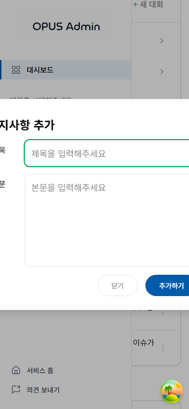
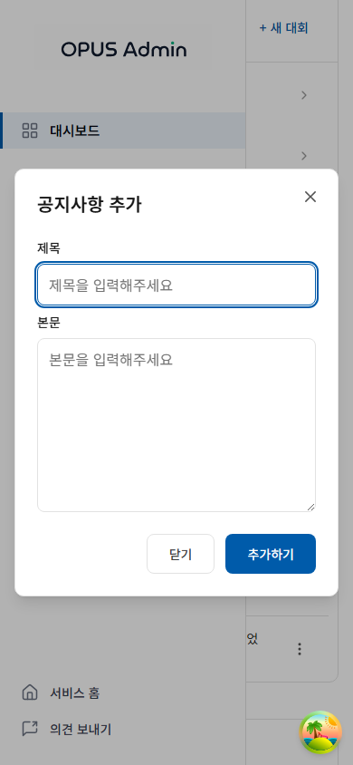
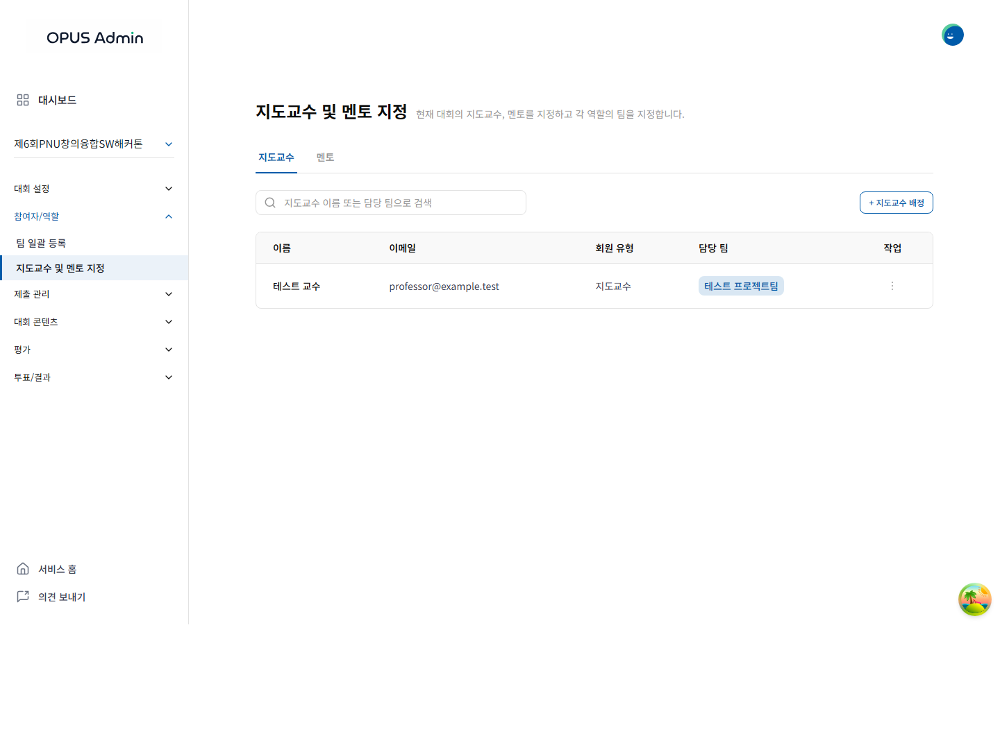
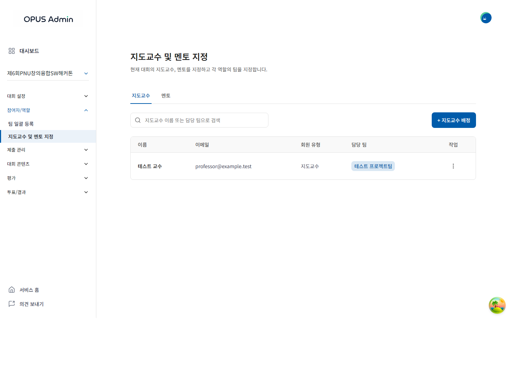
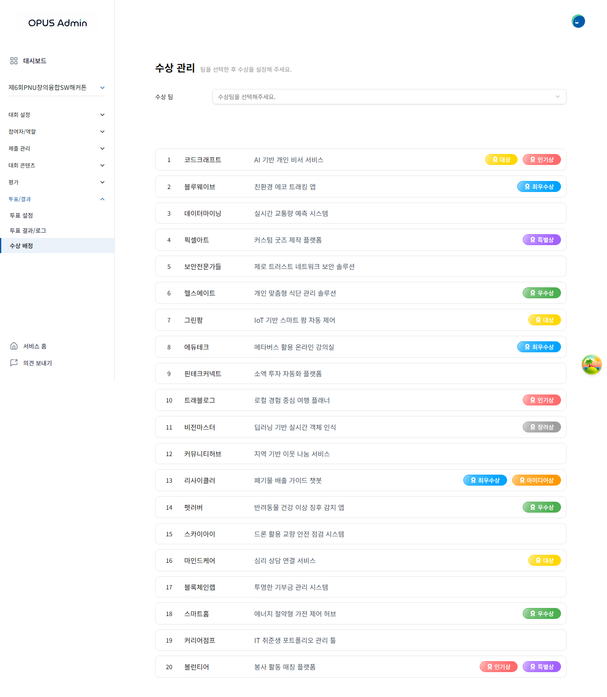
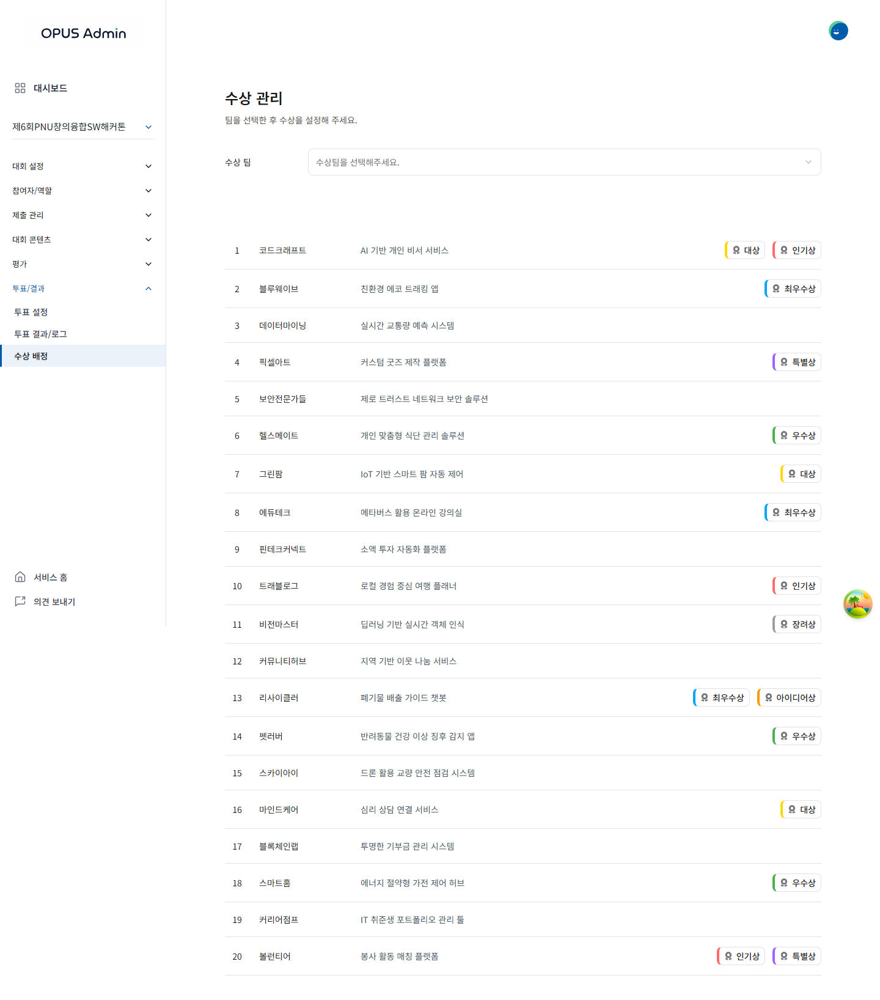
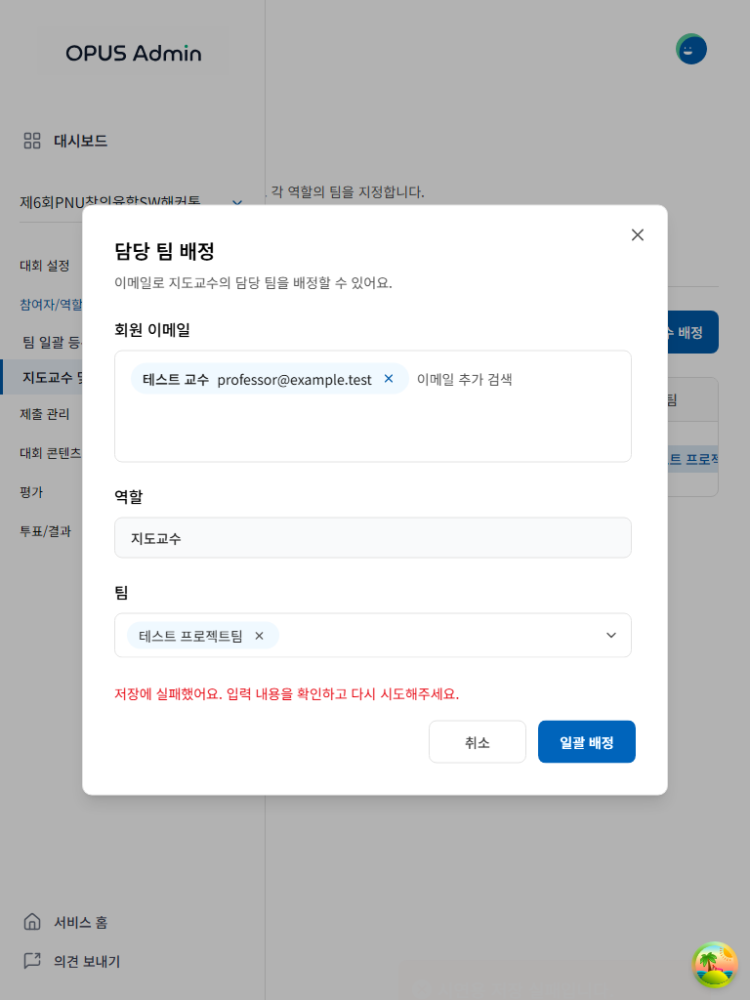
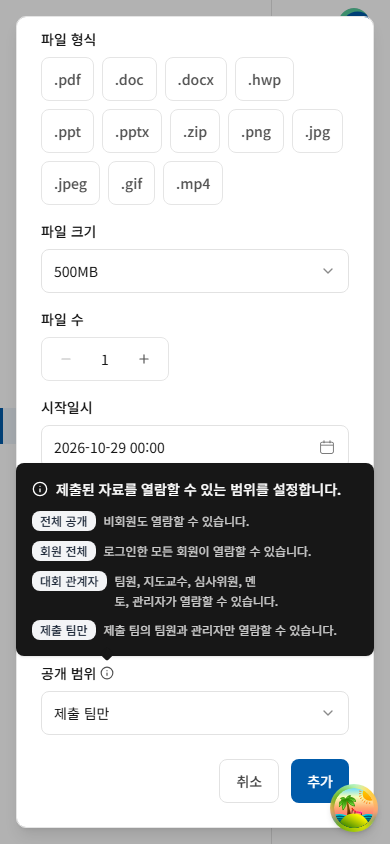

# 관리자 공통 UI 검토 — #298

## 기준과 범위

develop `0fd079e8687c3026c8494fe0c86ffcb6c6962522`에서 독립적으로 변경했다. 관리자 홈과 대회 생성·프로젝트·제출·정렬·수상·필수 항목·대회 수정·팀 설정·역할 배정·분과·투표·공지·배너·통계를 살폈다. 기존 API, DTO, 권한 및 운영 정책은 유지한다.

- [OPUS Renewal Button, 14:73](https://www.figma.com/design/HbyxwchvTkzD4pbtdjCHkg/OPUS-Renewal?node-id=14-73), [TextField, 687:3271](https://www.figma.com/design/HbyxwchvTkzD4pbtdjCHkg/OPUS-Renewal?node-id=687-3271)의 디자인 컨텍스트와 이미지를 확인했다. mainBlue, 흰 배경, 얇은 중립색 테두리와 절제된 모서리를 기준으로 삼았다.
- [관리자 대시보드 명세](https://app.notion.com/p/3f5b174e8df681e6970ed9d80164de44)는 검토/디자인 진행 중이다. 확정되지 않은 대시보드 기능이나 정책은 구현하지 않았다. 현재 관리자 화면 전체에 대응하는 최종 Figma node는 확인되지 않아 최종 화면 일치를 주장하지 않는다.
- Renewal만으로 전체 디자인을 추론하지 않고 기존 관리자·공개 화면의 실제 렌더링, 공통 컴포넌트 및 `src/index.css` 토큰을 비교했다.

## 설계와 직접 이미지 검토

| 발견한 문제 | 변경과 확인 |
| --- | --- |
| 제목 옆의 작은 회색 설명, 화면마다 다른 버튼·입력·메뉴 | 제목과 설명을 세로로 배치하고 본문/보조 정보의 위계를 정리했다. 기본 관리 버튼·선택·메뉴에는 44px 높이와 파란 포커스를 적용했다. |
| 모바일 공지 모달의 제목·입력·닫기 버튼 잘림 | 입력을 한 열로 배치하고 모달을 viewport에서 16px 안쪽으로 제한했다. 390px Before/After에서 제목과 모든 액션이 보이는 것을 확인했다. |
| 공개 범위 툴팁의 배경 토큰 누락, 오른쪽 배치의 모바일 잘림 | 중립색 어두운 배경과 맞는 화살표를 적용했다. 첫 재캡처에서 잘림을 발견해 위쪽 배치로 수정했고, 3개 너비에서 양쪽 경계와 실제 이미지를 재확인했다. |
| 밝은 상훈 색 위의 흰 글씨, 행마다 반복되는 박스 | 읽는 글씨는 어둡게 유지하고 지정 색은 왼쪽 표식으로 남겼다. 목록은 얇은 구분선으로 정리했다. 수상 선택·삭제는 키보드로 접근 가능한 버튼이다. |
| 저장 실패 후 닫힘, 삭제 모달 중복, 조회 실패가 빈 목록으로 보임 | 요청 중 액션과 닫힘을 잠그고 실패 시 입력과 모달을 유지한다. 삭제 모달은 목록 밖에 하나만 렌더링한다. 목록 로딩·오류·재시도·빈 결과를 구분한다. 다른 삭제 대상에 재진입하면 이전 오류를 초기화한다. |
| 중첩 팀 선택의 Escape가 배정 모달까지 닫음 | 첫 Escape는 팀 선택만 닫고 두 번째에 부모 모달을 닫도록 이벤트를 조정했다. 실제 배정 입력·저장 시나리오에서 확인했다. |

공개 화면에서도 쓰는 `AdminActionButton`, `AwardTag`, QueryWrapper의 오류 표현은 관리자 레이아웃 내부의 작은 컨텍스트로 범위를 제한했다. Input/TextArea/Select/Dialog는 명시적 `appearance="admin"` 옵션을 사용한다. 공통 테이블은 native table을 유지하고, 탭은 `aria-pressed` 버튼 그룹으로 표현한다. 새 상태 관리 라이브러리나 전역 디자인 시스템은 추가하지 않았다.

## 검증 근거

PR #314는 아직 develop에 병합되지 않았다. QA 기반 커밋 `545203c4e13aed2e90adc1c01c87db5bbd546b73`의 **기존** `tests/browser-visual-qa.cjs`와 `docs/visual-qa.md`를 별도 checkout에서 재사용했다. 기능 브랜치에는 그 커밋을 병합하거나 Playwright 설정·패키지를 중복 추가하지 않았다. develop에서의 통합 QA는 #314 병합이 선행 조건이다.

Windows, Chromium/Playwright 1.55, 로컬 MSW 개발 서버, 1440·768·390px에서 실행했다. 매 너비마다 새 브라우저 context와 합성 역할을 사용했다. 실제 계정·운영 API 요청은 사용하지 않았고, 미처리 API는 기존 네트워크 가드로 차단했다. 한글 폰트와 실제 콘텐츠가 준비된 뒤 촬영했다. 아래 JSON은 성공한 최종 실행 기록이며, 이전 실패/중간 캡처를 통과 결과로 사용하지 않는다.

| 기록 | 캡처 | 확인 범위 |
| --- | ---: | --- |
| `before.json`, `after.json` | 각각 51 | 15개 관리자 화면과 카테고리·공지 모달, 3개 너비. 마지막 수상 목록 수정은 아래 별도 실행으로 갱신했다. |
| `states.json` | 57 | 카테고리·공지·분과·제출·배정의 요청 중 중복 방지, Escape 잠금, 오류 유지, 재시도 성공, 모달 경계, 필터·투표 조작. 45개 동작 판정. |
| `extra.json` | 33 | 제출 상세/피드백/다운로드 목록, 툴팁 경계, 긴 카테고리·조회 상태·재시도, 학생/비로그인 관리자 차단. |
| `queries.json` | 36 | 분과·프로젝트·공지·역할의 로딩/오류/재시도/빈 결과. |
| `awards.json` | 9 | 최종 수상 목록·선택·색상 옵션, 키보드 열기와 Escape 포커스 복귀. 관리자 수상 API의 실제 경로/DTO를 합성 응답으로 재현했다. |
| `reset.json` | 6 | 1440·390px의 프로젝트·역할·제출 삭제 오류 후 재진입 초기화. |
| `public-comparison.json` | 13쌍 | 기존 공개 홈·로그인·온보딩·회원가입·모바일 메뉴 PNG가 변경 전후 바이트 단위로 동일했다. 해당 13개 화면에 한정한 근거다. |

타입 검사/프로덕션 빌드, ESLint, 기존 제출 저장 테스트 15개도 확인했다. 기존 ESLint 경고 5건과 큰 JS 청크 경고는 남아 있다. 청크 분리는 별도 #329 / PR #337 범위다. 이 UI 작업의 성능 개선 수치를 주장하지 않는다.

[재현용 시나리오](scripts.md)는 기존 QA checkout의 `.qa`에 두고 사용한다. 새 검증 프레임워크가 아닌 기존 runner의 Chromium·네트워크 가드·준비 조건을 재사용하는 일회성 검토 시나리오다.

## 남은 범위와 병합 시 주의

- **#299 미완료:** 272px 고정 사이드바와 본문 최소 너비 때문에 페이지 전체가 768px에서 256px, 390px에서 634px 넘친다. 모바일 수상 팀 선택은 사이드바가 포인터를 가로막는 경우도 재현했다. 키보드 조작 및 모달/툴팁 크기를 확인했지만 관리자 페이지 전체의 모바일 사용성을 완료로 표시하지 않는다.
- 관리자 최종 Figma 화면, 실기기 가상 키보드·터치·스크린리더, 실제 백엔드 저장/SSO/파일 다운로드 결과는 미검증이다. 특히 다운로드 탭은 안전한 목록만 검토했다.
- 여러 독립 UI PR이 같은 공통 파일을 다룰 수 있으므로 병합 후 공개/관리자 화면을 함께 검토해야 한다.
- 모바일 바텀 시트는 후속 #299에서 짧은 선택·필터에 적합한지 비교할 아이디어다. 모든 모달을 전환하는 확정 요구사항으로 취급하지 않는다.

## 대표 이미지

모두 저장소의 합성 데이터와 `example.test` 주소다. 원본 PNG를 수정하지 않았다.

| 화면 | Before | After |
| --- | --- | --- |
| 공지 모달 390px |  |  |
| 역할 목록 1440px |  |  |
| 수상 목록 1440px |  |  |

