# 관리자 모바일 UI 검토 — #299

기준: develop `0fd079e8687c3026c8494fe0c86ffcb6c6962522`, 구현 `2d1160c`, 2026-10-29.

## 디자인 근거와 범위

- [관리자 루트 Notion 명세](https://app.notion.com/p/3f5b174e8df681e6970ed9d80164de44)는 검토/디자인 진행 중이다. 빠른 작업, 이력, 개인화 등 미확정 기능을 추가하지 않았다.
- [OPUS Renewal 관리자 루트 650:7217](https://www.figma.com/design/HbyxwchvTkzD4pbtdjCHkg?node-id=650-7217)와 사이드바 160:1876의 실제 디자인 컨텍스트/이미지를 확인했다. 데스크톱 시안이며 최종 모바일 화면과 일치한다고 주장하지 않는다.
- 기존 관리자 실제 렌더링, OPUS mainBlue/중립색, 기존 Header/Sheet/Dialog/Select/Popover를 함께 기준으로 삼았다.
- 사용자가 제안한 바텀 시트는 제출 현황과 다운로드의 짧은 필터 선택에 적용했다. 검색과 결과는 본문에 남기고, 긴 입력 폼은 viewport 안에서 스크롤되는 Dialog를 유지한다. 드래그로 시트를 닫는 기능은 제공하지 않는다.

## 발견과 보완

| 실제 문제 | 보완 |
| --- | --- |
| 고정 사이드바와 본문 최소 너비가 390px 화면 대부분을 가림 | 1024px 미만에서는 헤더 메뉴로 여는 왼쪽 Sheet, 큰 화면은 기존 고정 탐색 유지 |
| 프로젝트 제목/분과/제출 여부/작업이 한 줄에서 밀림 | 모바일 이름·값 목록과 세로 배치. 주요 액션을 숨기지 않음 |
| 제출·역할 표의 가로 스크롤로 정보 관계를 파악하기 어려움 | 하나의 열/액션 정의로 데스크톱 표와 모바일 목록 렌더링. 한 번에 하나의 뷰만 마운트 |
| 공지 날짜의 과도한 줄바꿈, 원문 URL 때문에 긴 대시보드 | 날짜를 제목 아래 배치하고 설명형 링크, 모바일 섹션 간격 축소 |
| 투표 순위의 분과/득표 수가 잘리고 로그 날짜가 세로로 분절 | 순위·팀·프로젝트·분과·득표 수 재배치, 로그는 레이블과 값, 집계는 모바일 세 열 |
| 500px 공지 폼과 긴 제출 폼이 화면을 벗어남 | 좌우 16px 여백과 동적 화면 높이 제한, 내부 스크롤, 모바일 한 열 입력 |
| 중첩 Select의 Esc가 바텀 시트까지 닫음 | 선택창 열림을 관리하고 Esc를 안쪽 선택창부터 처리 |
| 정렬 행 전체가 드래그 영역, 모바일 핸들이 숨겨짐 | 보이는 44px 전용 핸들, 핸들만 touch-action 제한, 키보드 정렬 좌표 적용 |
| 동일한 체크박스 레이블을 DOM id로 재사용 | React useId로 연결, 다운로드 선택에는 모바일 44px 터치 영역, 포커스 표시 |

API/DTO/권한 정책과 데이터 조회·변경 훅은 유지했다. 공통 목록 컴포넌트는 표현만 담당한다. 성능 향상을 측정하거나 주장하는 변경이 아니다.

## 검증 증거

#314는 아직 미병합이다. 준비된 해당 checkout의 `tests/browser-visual-qa.cjs`와 네트워크 가드를 재사용했다. 패키지/브라우저 환경이나 CI를 중복 구성하지 않았다. 시나리오와 실행 방법은 [scenarios.md](scenarios.md)에 있다.

| 자료 | 범위 |
| --- | --- |
| `pages.json` | 관리자 15개 경로와 공지·카테고리 폼, 1440/768/390px, 51 캡처 |
| `interactions.json` | 메뉴, 필터, 상세/피드백, 다운로드, 폼, 정렬, 역할, 통계 등 42 캡처와 동작 판정 |
| `stress.json` | 긴 이름·이메일·선택지·상훈, 터치 정렬, 390×420 폼 하단 접근, 15 캡처 |
| `states.json` | 로딩/빈 목록/오류/재시도, 긴 카테고리, 학생·비로그인 접근 차단, 33 캡처 |
| `before.json` | develop 390px viewport의 가림과 634px 문서 가로 넘침 |
| `public-comparison.json` | 기존 공개 화면 13장의 이미지 비교 |

공개 화면의 한 초기 실행에서 데스크톱 홈의 크기/배치가 다르게 캡처되었다. 소스 변경 없이 전체를 다시 촬영한 결과 13장 모두 develop 기준 PNG와 byte 단위로 같았다. 홈만 새 context에서 세 번 더 확인해 같은 결과와 제목 63.36px/viewport 1440px를 기록했다(`public-home-repeat.json`). 첫 차이의 정확한 원인은 확정하지 않았으며, 해당 초기 실행을 최종 근거로 사용하지 않았다.

위 최종 관리자 캡처의 문서 가로 넘침은 모두 0이다. 이것만으로 시각적 완성도를 판정하지 않고 PNG를 직접 열어 제목/본문 위계, 날짜·배지·액션 정렬, 여백, 팝업 경계를 검토했다. 초기 공지 폼 잘림, 통계 정보 누락, 검색 입력과 배정 버튼 겹침, 과도하게 늘어난 분과 태그를 수정한 뒤 다시 캡처했다.

메뉴의 같은 경로 선택/경로 변경/화면 크기 전환, Esc와 포커스 복귀, 필터 선택·초기화·중첩 Esc, 선택 다운로드의 정확한 대상 payload, 키보드 순서 변경 후 전체 순서 payload, 터치 드래그를 확인했다. 로컬 MSW 합성 데이터만 사용하고 미처리 API/외부 요청은 기존 가드로 차단했다. 개발 도구가 버튼을 가리는 것은 운영 UI와 무관하므로 최종 관리자 캡처에서 `.tsqd-parent-container`만 숨겼다.

TypeScript와 production build, ESLint, 기존 제출 저장 테스트 15개를 실행했다. ESLint의 기존 경고 5개와 기존 번들 크기 경고는 남아 있다. 번들 분할은 별도 성능 PR #337에서 다룬다.

## 대표 이미지

| 프로젝트 관리 390px — develop | #299 |
| --- | --- |
| 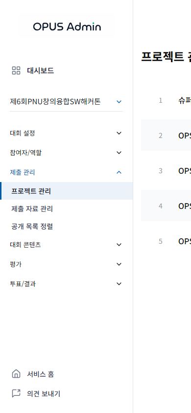 | 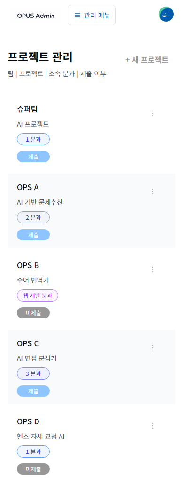 |

| 제출 관리 390px — develop | #299 |
| --- | --- |
| 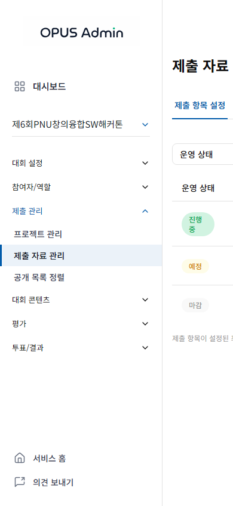 | 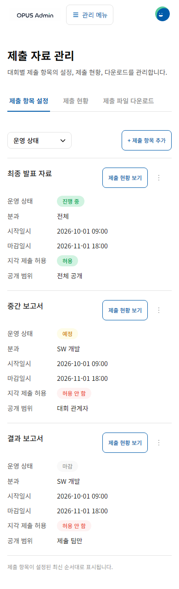 |

| 필터 바텀 시트 | 관리자 메뉴 |
| --- | --- |
| 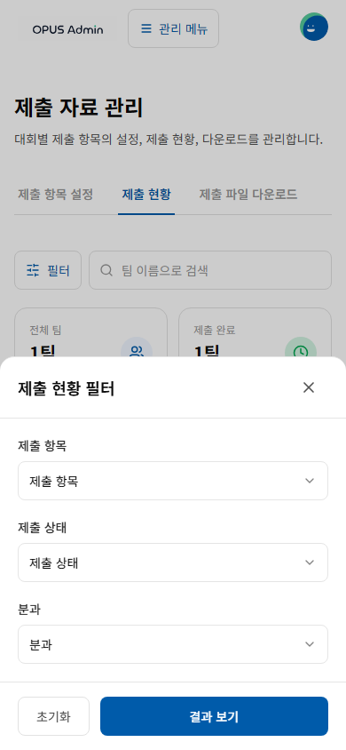 | 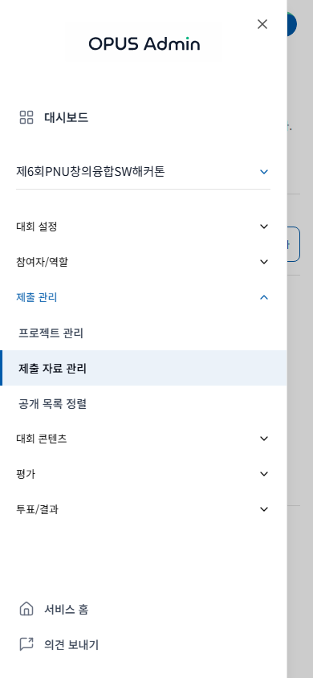 |

| 투표 정보 재배치 | 공지 입력 |
| --- | --- |
| 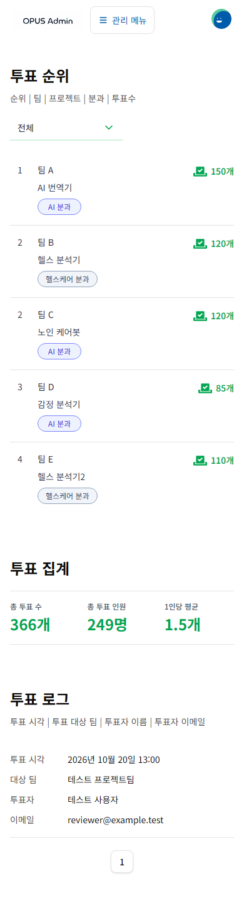 | 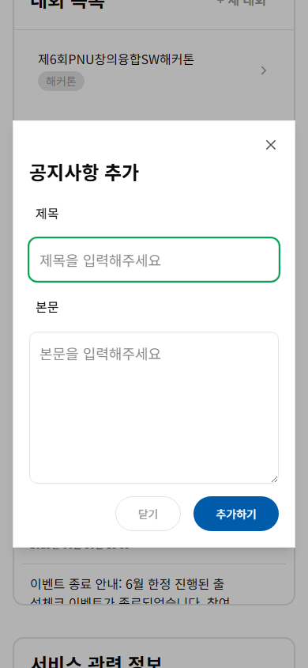 |

## 통합과 미검증 범위

- #338의 공통 스타일/오류 처리와 #299의 반응형 배치는 최신 develop에서 각각 독립적으로 시작했다. 임시 checkout에서 34개 파일의 충돌을 검토해 공통 스타일·저장 오류 처리와 모바일 표현을 함께 유지했다. [통합 해결안](integration-338.patch)은 #338 커밋 `193a5ddee112bd57a4c9d063844436d429cf3fb5`에 적용하는 패치이며, 두 기능 브랜치의 의존성이나 병합 커밋을 추가하지 않았다.
- 임시 조합에서 기본 51장, 상호작용 42장/10개 판정, 긴 데이터·터치 15장/2개 판정, 저장 중/실패/재시도 57장/45개 판정을 확인했다. `integration-*.json`에 원시 결과를 남겼으며 failures와 문서 넘침은 모두 0이다. 실제 모바일 제출 현황·공지 폼·통계·긴 상훈·역할 오류, 태블릿 프로젝트 목록과 데스크톱 대시보드를 직접 열어 검토했다. 조합한 소스의 TypeScript/build와 ESLint도 확인했다.
- #314와 기능 PR이 develop에 병합된 상태의 CI/통합 QA는 아직 수행할 수 없다. 임시 checkout 검증이 실제 브랜치 병합을 대신하지 않는다.
- 실제 백엔드 저장·SSO·생성 파일 내용, 실기기 Safari/Chrome, 가상 키보드/IME, 스크린리더는 미검증이다. 390×420은 낮아진 viewport 재현이며 실제 가상 키보드 시험으로 간주하지 않는다.
- 관리자 최종 모바일 Figma 명세는 미확인이다. 새로운 운영 정책, 서버 계약이나 보안 권한을 추정해 추가하지 않았다.

| 임시 조합 — 제출 현황 | 투표 통계 | 배정 오류·재시도 |
| --- | --- | --- |
| 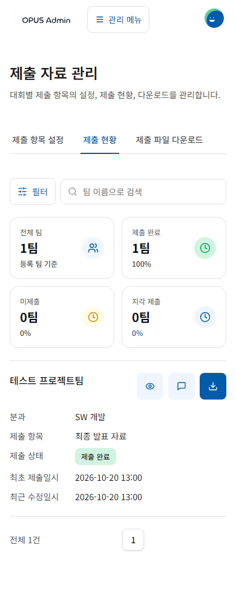 | 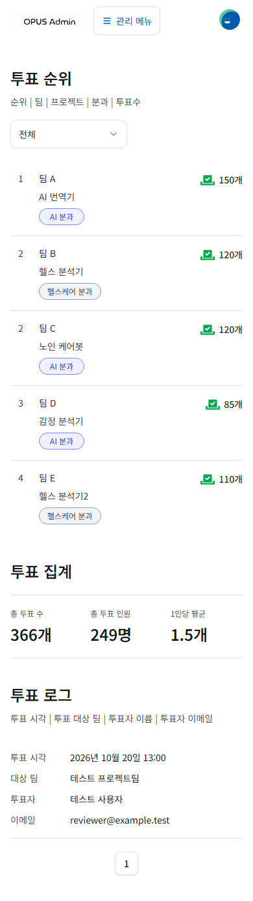 | 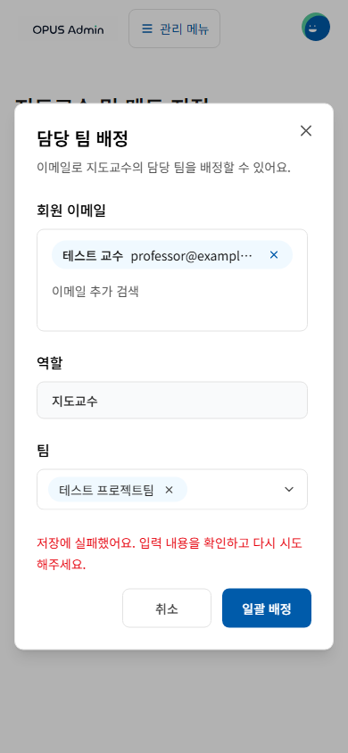 |
