# 대회 탐색 사이드바 검토 — #304

기준: develop `0fd079e8687c3026c8494fe0c86ffcb6c6962522`, 2026-10-29. 이 기능 브랜치는 develop에서 독립적으로 생성했다.

## 요구사항과 디자인 근거

- [#304](https://github.com/PNUops/opus-frontend/issues/304)의 계층 탐색·긴 이름·헤더 진입점·너비 조절 요구를 적용했다. 사용자가 2026-10-29 확정한 **이 기기에 저장 + 기본값 복원** 정책을 따른다. 서버 저장이나 계정 간 동기화는 추가하지 않는다.
- [10/8 회의](https://app.notion.com/p/3f3b174e8df68120a9f1d07dc6670a04)의 기존 관리자 정렬 기능과 [전체 대회 조회 명세](https://app.notion.com/p/33eb174e8df68098b81ae9203a375cbf)를 대조했다. 후자는 구체적인 사이드바 시안/본문이 비어 있어 새 정책의 근거로 쓰지 않았다.
- OPUS Renewal의 SCREENS 14:6, 관리자 14:12, ARCHIVE 14:11, FLOWS 14:9에서 공개 카테고리→대회 트리의 정확한 최종 node를 확인하지 못했다. [Header 149:513](https://www.figma.com/design/HbyxwchvTkzD4pbtdjCHkg?node-id=149-513)의 디자인 컨텍스트와 이미지는 로고/액션 위계·타이포그래피 참고로 확인했다. 관리자 헤더를 공개 서비스 화면의 완성 시안으로 간주하지 않았다.
- 기존 OPUS 홈/대회 화면을 실제 렌더링했다. `src/index.css`의 mainBlue/mainGreen/subGreen/중립색과 홈의 navy/cyan, 기존 Tooltip/Sheet/Popover 및 정렬 API를 재사용했다.

## 설계와 직접 이미지 검토

카테고리는 중립적인 글자와 펼침 화살표로, 선택 대회는 옅은 배경과 왼쪽 선으로 구분했다. 폴더 아이콘·개수·반복 상태 점을 덜어 대회명이 주 정보가 되도록 했다. 목록 하나만 스크롤하며 의견 보내기와 너비 복원은 별도 고정 영역에 둔다.

데스크톱 이름은 최대 두 줄, 키보드 포커스/hover 시 전체 이름 툴팁을 제공한다. 모바일은 전체 이름을 줄바꿈한다. 30개 대회를 넣어 마지막 항목과 관리자 정렬 손잡이에 접근했다. 기존 384px 확장 제한으로 잘리던 항목을 목록 스크롤 안에서 탐색한다.

실제 1024px 본문을 보면서 4열 프로젝트 카드가 과도하게 좁아지는 것을 확인해 데스크톱 시작점을 1280px로 정했다. 기본 280px, 최소 240px, 최대 400px이며 본문에 최소 960px을 남긴다. 1280px에서는 상한이 320px이다. 일시적인 화면 축소는 저장한 선호 폭을 덮어쓰지 않는다. 경계 드래그/방향키/Shift+방향키/Home/End, 두 번 클릭과 명시적인 복원 버튼을 제공한다. 저장값은 타입·범위를 검증하고 저장소 예외에도 화면 조절은 유지한다.

좁은 화면에서는 로고 오른쪽의 `대회`/`대회 목록` 버튼으로 왼쪽 Sheet를 연다. 긴 계층 탐색에는 왼쪽 드로어를 유지했다. 짧은 필터를 위한 바텀 시트는 별도 #339 범위다. 선택·동일 경로 선택·라우트 변경·큰 화면 전환 시 닫기, Escape, 오버레이 클릭과 포커스 복귀를 확인했다.

이미지 및 상호작용 검토에서 다음 문제를 수정하고 재촬영했다.

- Tooltip의 asChild와 NavLink 함수형 className 조합에서 선택 스타일이 잘못 전달되던 것을 경로에서 계산한 정적 className으로 수정했다.
- 정렬 편집의 긴 이름이 작은 아이콘/깊은 들여쓰기에 눌리지 않도록 정리하고 손잡이·설정·취소·저장을 44px로 확보했다. 줄 수가 다른 항목을 이동할 때 scale 변형 대신 translate만 적용한다.
- 모바일 정렬 팝업이 Sheet 오버레이에 가려 클릭되지 않던 문제를 modal Popover와 레이어 순서로 수정했다. Escape는 안쪽 팝업만 닫고 설정 버튼으로 포커스를 복귀시킨다.
- 드래그 손잡이와 정렬 종료 포커스가 화면 스크롤을 이동시키지 않도록 보완했다. 편집 중 사이드바 resize에도 순서 초안을 유지한다.

## 검증 근거

#314는 아직 Draft·미병합이다. 준비된 기존 checkout `545203c4e13aed2e90adc1c01c87db5bbd546b73`의 Playwright, 폰트 확인, 네트워크 가드를 재사용했다. 별도 의존성/CI/브라우저 설정은 추가하지 않았다. MSW 합성 데이터와 합성 관리자만 사용했다.

| 원시 결과 | 캡처 | 행동 판정 | 범위 |
| --- | ---: | ---: | --- |
| before.json | 12 | 0 | develop, 같은 일반/긴 목록 |
| pages.json | 15 | 3 | 1440/768/390 홈·대회·긴 목록·마지막 항목 |
| interactions.json | 12 | 13 | 저장/새로고침/화면 상한/취소/복원, 포커스·경로, 키보드 정렬 요청 본문 |
| states.json | 24 | 15 | 초기 로딩·실패·재시도·오래된 데이터·빈 목록·긴 정렬·저장소 예외 |
| extra.json | 10 | 7 | 350/1024/1279/1280 헤더, 390 터치 정렬·중첩 Escape·390×420 |
| integration-interactions.json | 12 | 13 | #332/#337/#339 + #304 임시 조합의 전체 상호작용 |
| integration-header.json | 15 | 4 | 같은 조합의 1440/768/390/350 로그인 헤더·공개/관리자 메뉴 분리 |
| integration-extra.json | 10 | 7 | 같은 조합의 작은 헤더·터치·중첩 팝업 포커스 복귀 |

표의 최종 결과는 failures와 문서 가로 넘침 모두 0이다. PNG를 직접 열어 타이포그래피·정렬·선택 위계·긴 이름·오류·팝업 경계를 검토했다. 자동 수치만으로 디자인 완료를 판정하지 않았다. 초기 픽스처의 캐시 객체 직접 변경과 준비 시점 문제는 바로잡았으며 실패한 중간 실행은 최종 증거에서 제외했다.

TypeScript/build, ESLint 오류 0(기존 경고 5), 너비 경계/저장값 검사 2개와 기존 제출 저장 15개를 확인했다. 기존 단일 번들 경고는 #337의 독립 성능 작업으로 유지한다. 이 PR에서 성능 향상 수치를 주장하지 않는다.

재현 방법과 실행한 합성 시나리오는 [scenarios.md](scenarios.md)에 있다.

## 대표 이미지

| 기존 1440px | 개선 1440px |
| --- | --- |
| 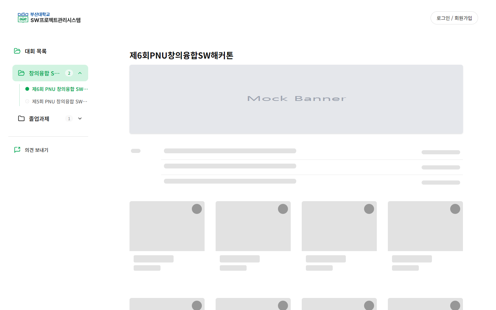 | 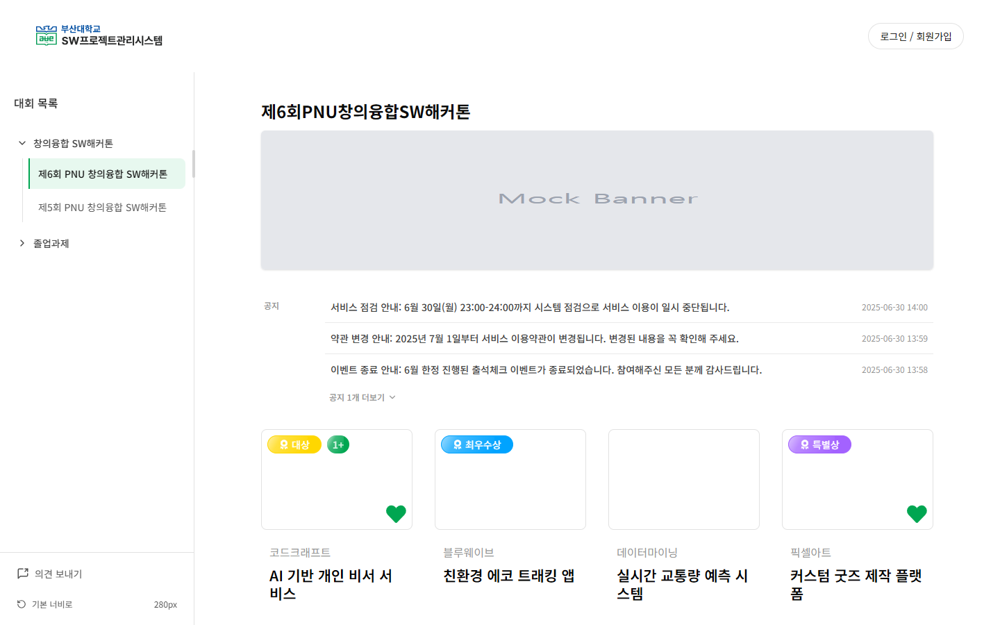 |

| 기존 긴 목록 390px | 개선 긴 목록 390px | 태블릿 768px |
| --- | --- | --- |
| 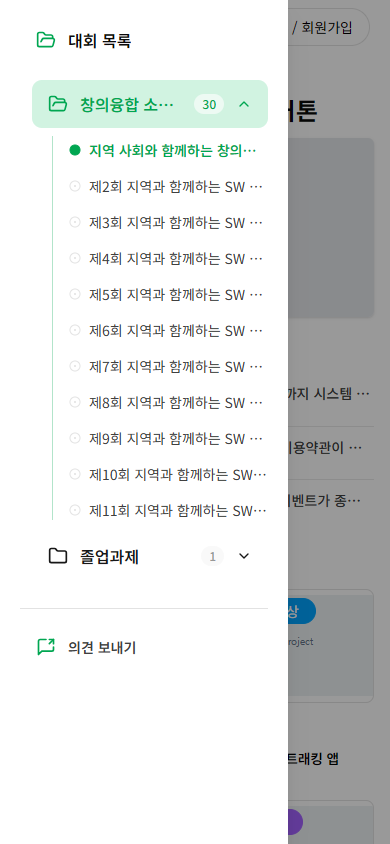 | 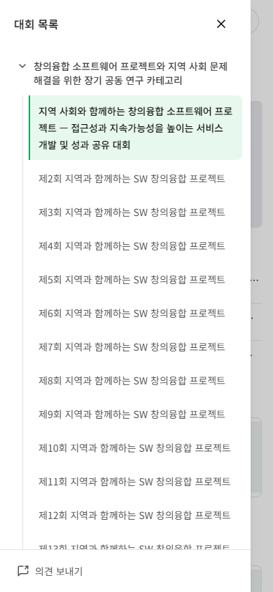 | 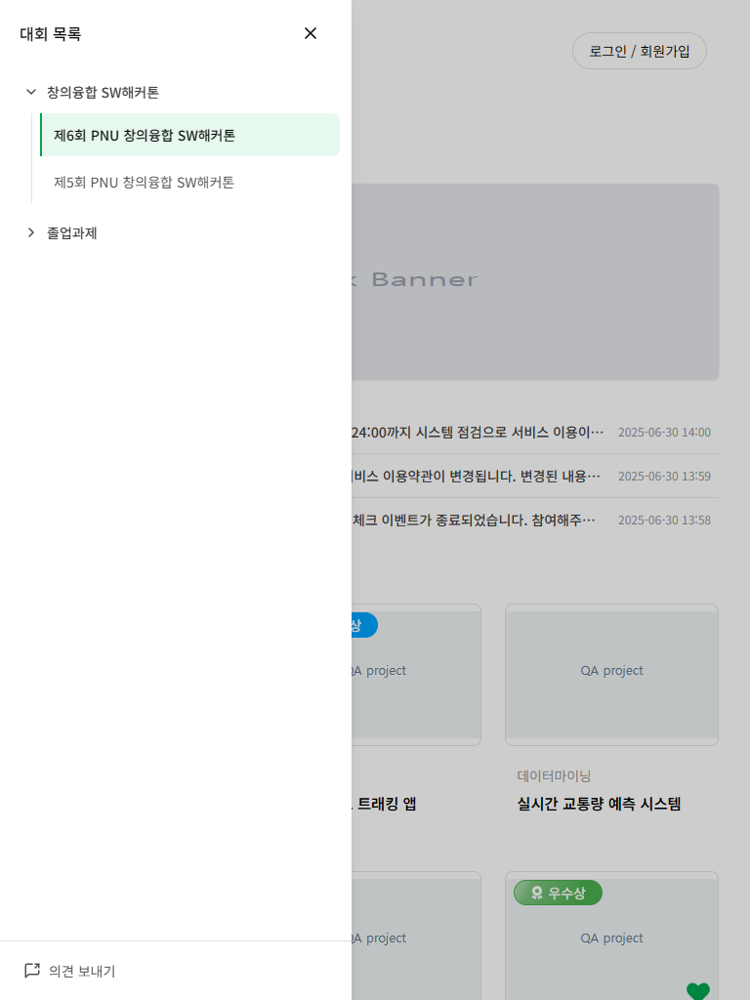 |

| 전체 이름 포커스 | 좁은 데스크톱의 상한 |
| --- | --- |
| 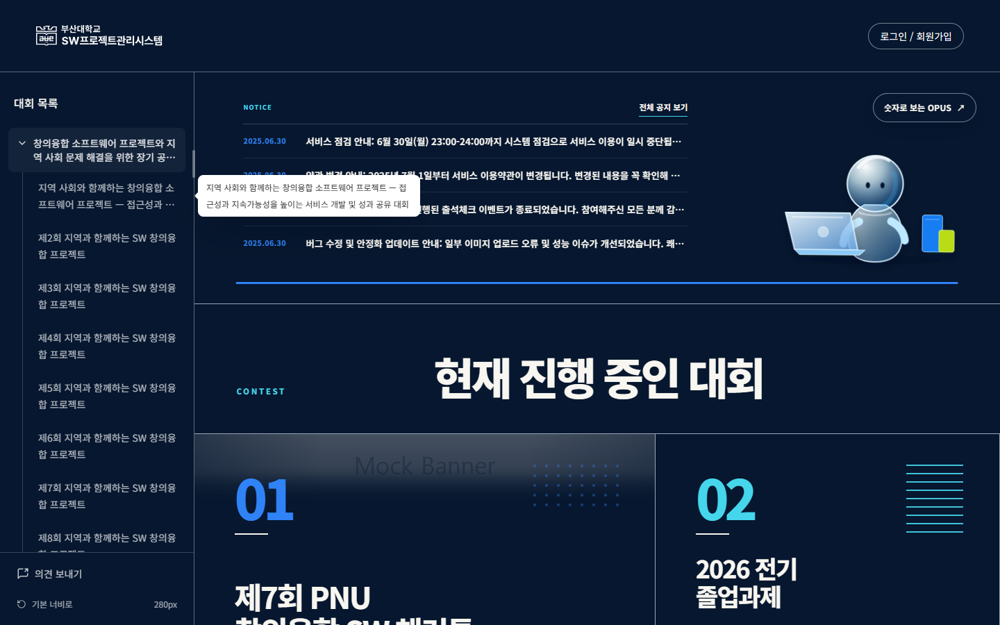 | 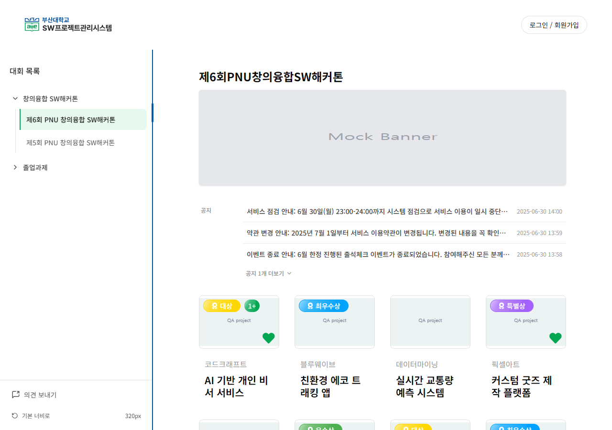 |

| 긴 정렬 이름 | 중첩 팝업 | 낮은 화면 | 오류·재시도 |
| --- | --- | --- | --- |
| 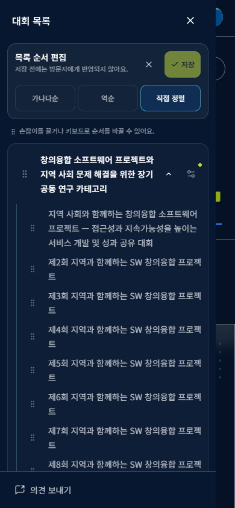 | 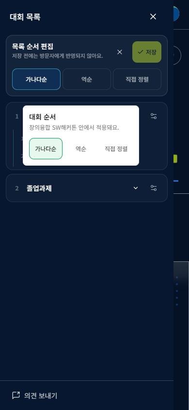 | 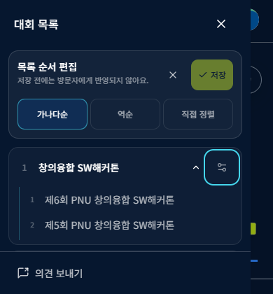 | 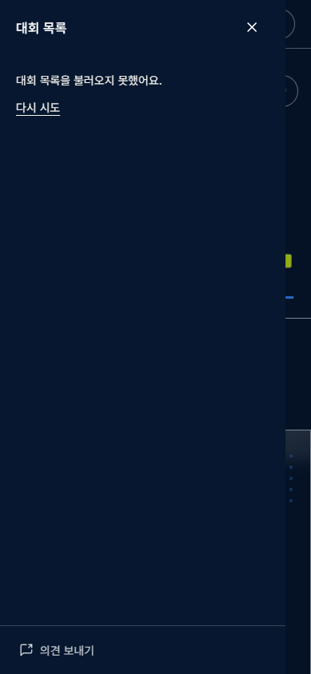 |

## 다른 PR과의 통합 및 미검증

- #332 `9662438`, #337 `6606a758`, #339 `8bd8d030`을 격리된 임시 checkout에서 결합하고 #304 소스를 적용했다. Header에서는 #339의 관리자 전용 로고/메뉴/패딩을, Sidebar에서는 #337의 lazy + DeferredContent를 함께 보존했다. [integration-337-339.patch](integration-337-339.patch)는 **이 브랜치 소스에 대한 두 파일의 통합 차이**다. #337의 DeferredContent와 #339의 나머지 소스가 함께 있어야 한다. 실제 기능 브랜치끼리는 병합하지 않았다.
- 조합의 공개/관리자 메뉴와 정렬, 포커스 및 build를 확인했다. #332 홈 개선까지 포함한 [350px 헤더](integration-home-350.png)와 [390px 관리자 헤더](integration-admin-390.png)를 직접 검토했다. 이 조합이 모든 열린 PR의 전체 회귀 검증을 의미하지는 않는다.
- #314의 develop 병합과 최종 통합 QA는 남아 있다. 정확한 공개 트리 Figma 최종 node 일치, 실제 서버 정렬 저장·실계정, 실기기 Safari/Chrome 터치·IME·스크린리더 음성은 미검증이다. CDP 터치와 낮은 viewport 검사를 실기기/가상 키보드 검증으로 간주하지 않는다.
- 너비는 origin별 브라우저 저장소에 남는다. 저장소 접근 실패 시 현재 화면에서만 조절되며 기기 간 동기화나 저장 성공을 보장하지 않는다.
