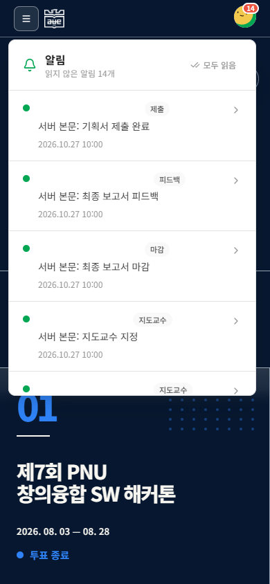
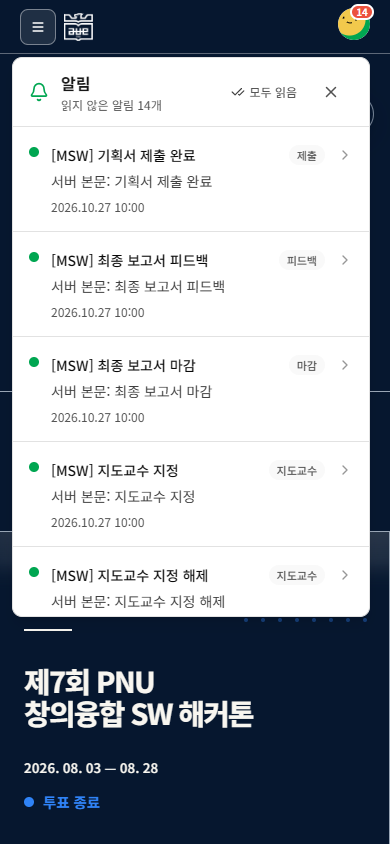
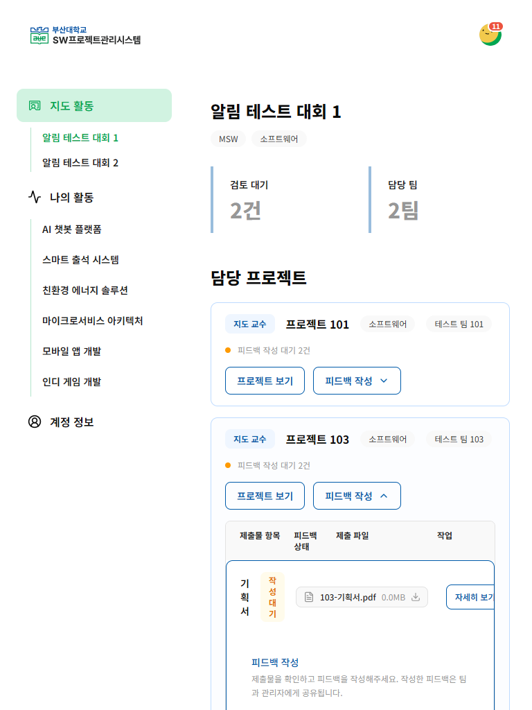
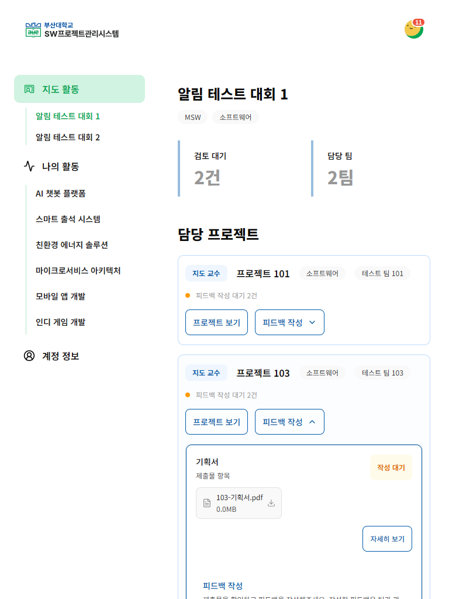
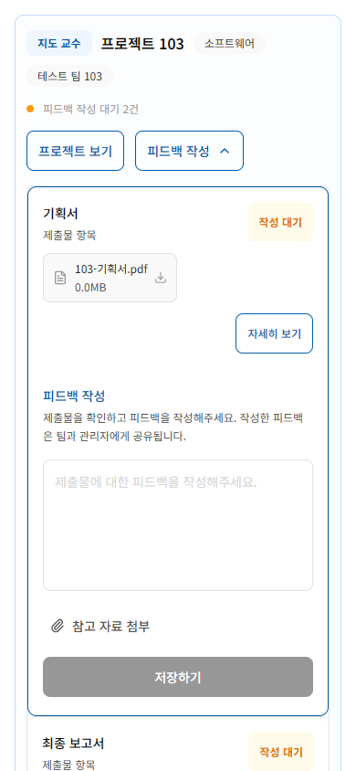
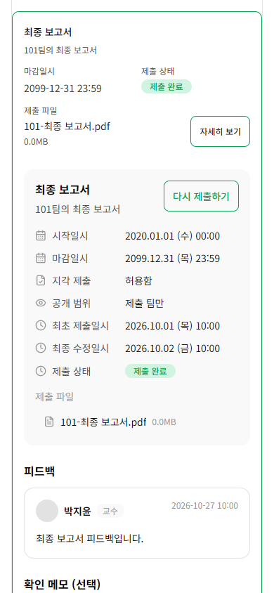
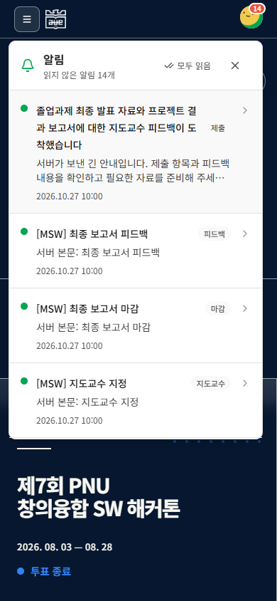
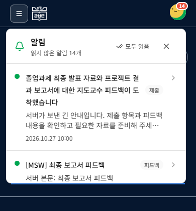
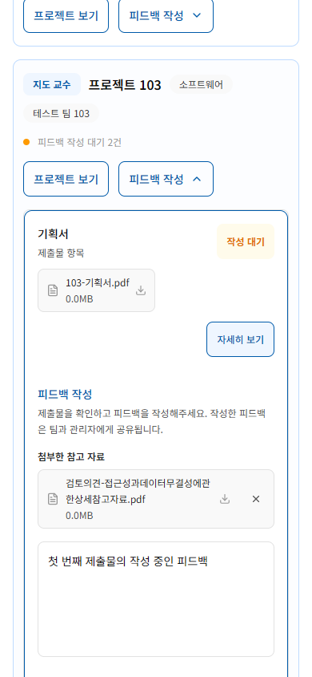

# 제출·지도 활동 알림 검토 기록

기준: `develop@0fd079e8687c3026c8494fe0c86ffcb6c6962522`, 2026-10-29. 원래 작업 폴더의 진행 중이던 #307 파일 20개를 별도 worktree로 복사해 이어서 작업했으며, 원본 SHA-256이 그대로임을 확인했다. 아래 Before는 이 기존 초안의 실제 렌더링이다.

## 명세와 디자인 근거

- [알림 명세](https://app.notion.com/p/3f3b174e8df681089dc0e292ae7978c9), [10/12 운영 회의](https://app.notion.com/p/3f9b174e8df681d8ab46fb75f2908443), [10/8 전체 회의](https://app.notion.com/p/3f3b174e8df68120a9f1d07dc6670a04)를 기존 #307/#276 및 BE 병합 상태와 대조했다.
- BE [#225](https://github.com/PNUops/opus-backend/pull/225), [#226](https://github.com/PNUops/opus-backend/pull/226), [#227](https://github.com/PNUops/opus-backend/pull/227)은 10/18 develop 병합 상태다. 제출·피드백은 제출물 ID, 마감은 제출 항목 ID이며 팀 ID 대체에 쓰지 않는다.
- OPUS Renewal [지도 활동·피드백 작성 414:2649](https://www.figma.com/design/HbyxwchvTkzD4pbtdjCHkg?node-id=414-2649)의 디자인 컨텍스트와 실제 이미지를 확인했다. 대회 요약 → 담당 프로젝트 → 제출물 → 피드백의 정보 위계와 OPUS 색상·타이포그래피를 참고했다. 알림 패널 자체의 확정 Figma node는 확인하지 못했다.
- 현재 OPUS의 실제 알림/마이페이지 화면, 공통 버튼·패널, `mainBlue`, `mainGreen`, 중립색 및 Noto Sans KR 토큰을 함께 검토했다. 전체 헤더·마이페이지 탐색을 새 디자인으로 교체하지 않았다.

## 문제와 구현 판단

| 실제 문제 | 변경과 이유 |
| --- | --- |
| 홈의 흰색 글자색이 알림 제목에 상속되어 제목이 보이지 않음 | 제목·본문·시간의 색과 위계를 명시하고 긴 제목은 줄바꿈한다. |
| 메뉴 전환 중 빠른 선택으로 알림 패널 상단이 화면 밖으로 밀림 | 프로필 메뉴의 크기·위치 전환을 짧은 페이드로 정리하고 동작 축소 설정을 존중한다. |
| 읽음 처리로 포커스된 버튼이 비활성화되면 Escape가 작동하지 않음 | 패널이 열린 동안 Escape를 처리하고 명시적인 닫기 버튼과 프로필 포커스 복귀를 제공한다. 닫힌 패널은 inert다. |
| 학생 768px 본문이 272px 넘침, 좁은 지도 활동 표에서 한글이 한 글자씩 줄바꿈 | 본문 flex 최소 너비를 바로잡고 좁은 화면의 제출물을 제목·상태·파일·작업 순으로 배치한다. 데스크톱 표의 정보 구조는 유지한다. |
| 모바일 제출 상세의 중첩 여백과 좁은 레이블 | 중복 패딩을 줄이고 날짜·파일·주요 작업이 읽히도록 재배치한다. |
| 알림의 제출물 ID를 팀 ID로 해석할 위험 | 순수한 경로/ID 검증과 기존 팀 조회 훅을 분리한다. 서버 쿼리는 보존하고 중복·잘못된 ID와 외부 경로는 안전하게 처리한다. |
| 팀·대회 이동 시 피드백 초안과 첨부 상태 혼동 | 대회/팀/제출물 키로 편집 상태를 보존하고 선택·조회 로직을 별도 훅으로 옮긴다. 담당 목록 재조회 실패 시 오래된 권한으로 편집하지 않는다. |
| 여러 대상의 연속 저장 중 이전 대상의 잠금이 풀림 | 대상별 진행 상태와 동기 잠금을 사용한다. 각 응답은 원래 대상의 파일 정리·캐시 갱신만 수행한다. |
| 읽음 요청의 경쟁·늦은 응답 | 전체/개별 처리를 직렬화하고 조회 취소 후 낙관적 갱신한다. 실패 시 복원하며 닫기·경로·계정 변경 뒤의 이동 및 이전 계정 캐시 복원을 막는다. |

지도 활동의 담당 프로젝트는 대회 탐색 사이드바와 다른 화면이다. 대회 탐색 사이드바는 **대회 카테고리 → 대회 제목**만 표시한다.

## 시각적 QA

#314가 아직 Draft·미병합이므로 해당 checkout의 기존 Playwright/Chromium, 네트워크 차단, 폰트 검증, 캡처 함수를 재사용했다. 새 검증 프레임워크나 패키지 의존성을 추가하지 않았다. 로컬 MSW 역할·데이터만 사용했으며 운영 API·실계정은 사용하지 않았다.

- 학생/교수/멘토, 1440×900 / 768×1024 / 390×844: 알림, 도착 위치, 본문 27장.
- 긴 제목·본문, 빈 목록, 오류, 로딩, 키보드 및 390×420: 상태 14장과 초안·파일·저장 동작.
- 실제 클릭으로 신규 7종, 기존 팀/댓글/수상 경로, 중복 ID, 외부 URL, 읽음 복원·경쟁, 닫기·경로·계정 변경, 단일/복수 지정, 권한 회수를 검증했다.
- 캡처 후 이미지를 직접 열어 제목 대비, 패널 경계, 카드·표의 정렬, 긴 파일명, 날짜 레이블, 버튼 크기와 내용 밀도를 검토했다. 발견한 문제를 수정하고 재캡처했다.
- 최종 기록에서 문서 가로 넘침과 예상하지 않은 외부 네트워크 요청은 0이다. 초기 실패/수정 전 로그는 최종 통과 증빙에 포함하지 않았다.
- QA 중 Vite 캐시 공유로 재최적화와 페이지 재로딩이 발생해 worktree별 임시 `cacheDir`을 분리했다. 지연 로딩 조합은 URL 변경뿐 아니라 목적지의 실제 렌더링을 기다린다.

### 주요 이미지

| 기존 초안 390px | 개선 390px |
| --- | --- |
|  |  |

| 기존 초안 768px | 개선 768px |
| --- | --- |
|  |  |

## 독립 PR과 통합 검토

기능 브랜치는 최신 develop에서 시작했다. 다른 기능 PR의 커밋을 포함하지 않는다.

- #276/#319의 단수 오기 제거는 별도 변경이다. standalone에서는 develop의 레거시 호환을 유지한다. #319 병합 시 새로 분리된 `constants/notification`, `targetPath`, `teamTargetPath`에서도 단수형을 제거해야 한다. `TEAM_AWARDS`가 BE 계약이다.
- #337의 지연 로딩, #339/#341의 관리자·대회 헤더/탐색을 덮어쓰지 않도록 별도 통합 worktree를 만들었다. #332 홈 변경도 포함한 화면에서 알림과 도착 화면을 확인했다.
- [통합 참고 패치](integration-319-337-339-341.patch)는 이 PR 기준 헤더와 enum 관련 5개 파일의 차이다. #337/#339/#341의 나머지 파일이 선행되어야 하며, 기능 브랜치에 바로 적용할 독립 기능 패치가 아니다. 적용 가능 여부를 확인했고 원본 브랜치에는 적용하지 않았다.

## 재현 자료와 한계

- [시나리오 원문](scenarios.md), JSON 기록과 위 PNG는 합성 데이터만 포함한다. [MSW 역할별 사용법](../../../src/mocks/README.md)은 저장/실패 데이터의 범위를 설명한다.
- TypeScript·ESLint·production build와 알림/지도 활동 및 제출물 회귀 테스트를 확인했다. 기존 린트 경고 5개와 기존 단일 번들 크기 경고는 별도 작업 범위다. 성능 개선 수치를 주장하지 않는다.
- 운영 DB enum 확장, 실제 이벤트 발송, 서버 배포, 실계정의 권한 회수와 브라우저 간 동작, 실기기·스크린리더는 미검증이다. FE의 방어 처리는 서버 권한 검증을 대신하지 않는다.
- 지도 매칭 요청/승인/반려, 수정 알림·쿨다운은 이 PR의 확정 정책으로 추가하지 않았다. #322 및 별도 계약에서 다룬다.
- #314와 기능 PR들의 develop 최종 병합 뒤 다시 확인해야 한다. 이 기록만으로 #307의 운영 통합 완료 조건을 완료 처리하지 않는다.
