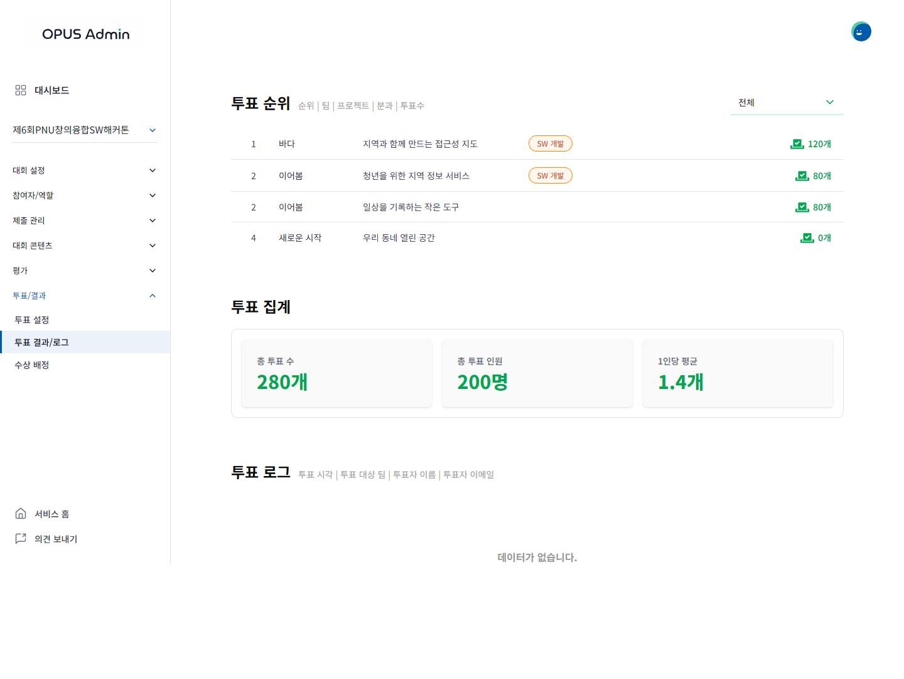
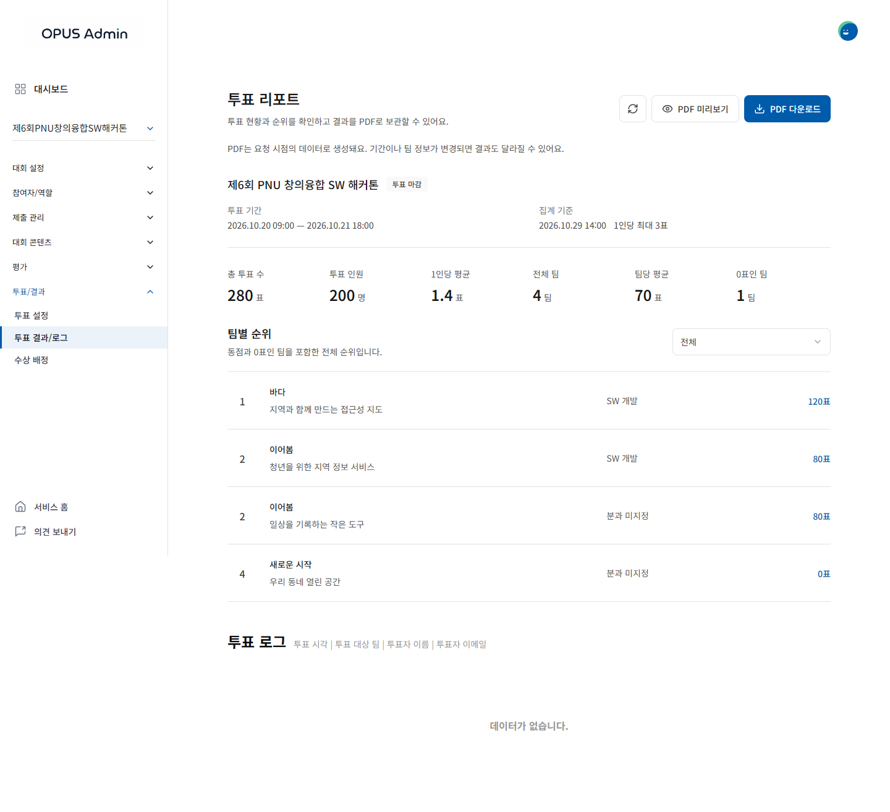
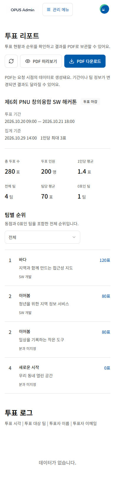
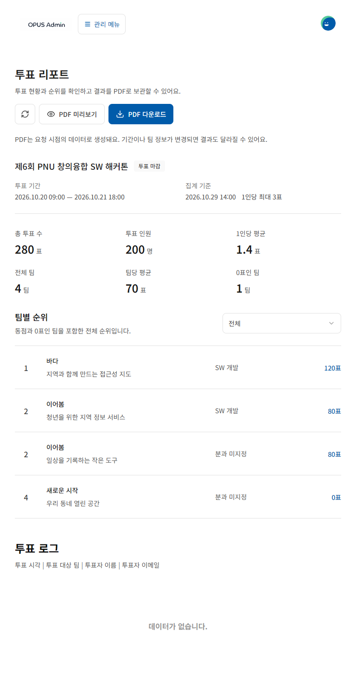
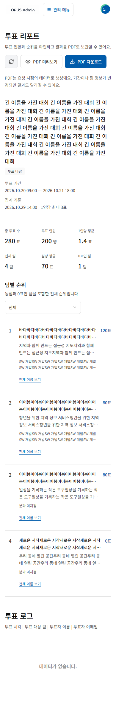
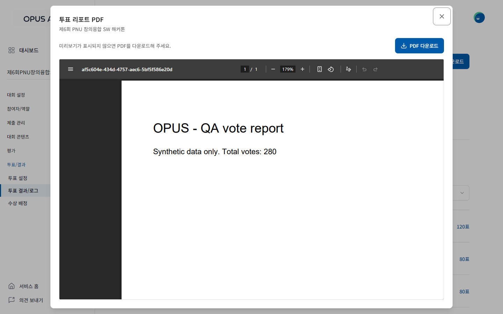
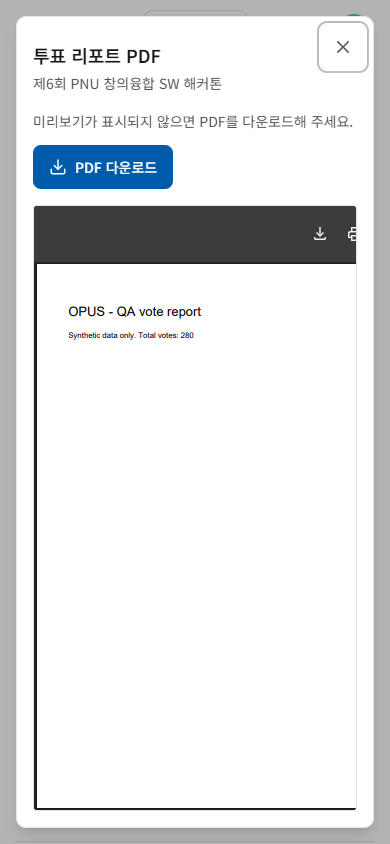
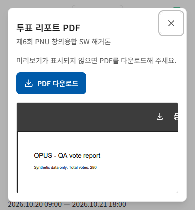
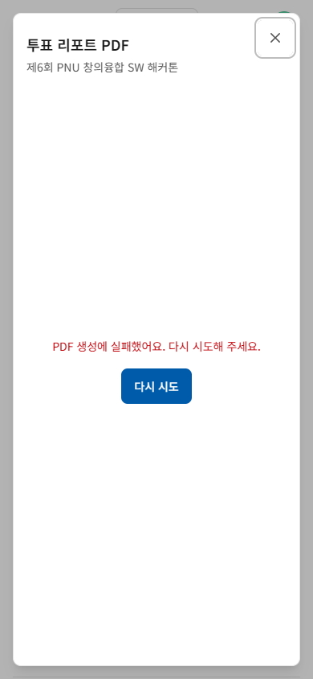
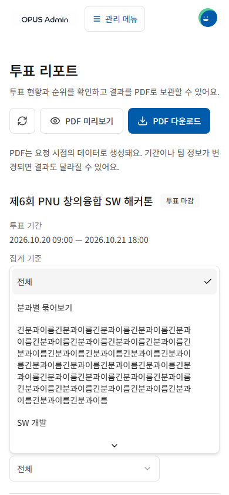

# 투표 리포트와 PDF 검토 — #311

기준: develop `0fd079e8687c3026c8494fe0c86ffcb6c6962522`, 2026-10-29. 기능 브랜치는 다른 FE PR을 포함하지 않는다.

## 계약과 디자인 근거

- [FE #311](https://github.com/PNUops/opus-frontend/issues/311), 병합된 BE [#232](https://github.com/PNUops/opus-backend/pull/232)~[#235](https://github.com/PNUops/opus-backend/pull/235)의 관리자 전용 리포트 계약을 적용했다. 조회는 `/votes/report`, PDF는 `/votes/report/download`다.
- 기본 집계 6개, 전체 순위와 분과 필터, 마감 여부·집계 시각 및 PDF를 제공한다. DTO의 나머지 차트를 임의의 새 분석 화면으로 확대하지 않았다. 기존 투표 로그를 유지했다.
- [연동 일정](https://app.notion.com/p/3f3b174e8df68027ba22cf4a0c8e5731), [회의 안건](https://app.notion.com/p/3f3b174e8df68095bafde114f52cd7a3)은 상세 리포트 UI 명세를 제공하지 않았다. OPUS Renewal SCREENS 14:6, 관리자 흐름 14:12, ARCHIVE 14:11, FLOWS 14:9 조사에서도 정확한 리포트 node를 찾지 못했다. 심사 결과 화면을 투표 리포트 시안으로 간주하지 않았다.
- 기존 OPUS 통계 화면을 실제 렌더링하고, [Button 14:73](https://www.figma.com/design/HbyxwchvTkzD4pbtdjCHkg?node-id=14-73)의 디자인 컨텍스트·이미지와 코드의 mainBlue/중립색, Dialog/Select/AdminActionButton을 확인했다. Figma와 화면 전체가 일치한다고 주장하지 않는다.

## 설계와 시각적 보완

요약을 먼저 배치하고 순위와 로그로 이어지도록 정보 순서를 정리했다. 반복 카드·그림자 대신 한 줄의 지표와 구분선을 사용한다. 모바일은 지표 세 열, 순위·이름·득표 수와 분과의 두 줄 배치다. 새로고침은 이름이 있는 44px 아이콘 버튼으로 줄여 PDF 액션과 함께 한 줄에 놓았다.

긴 이름은 두 줄과 전체 이름 펼침/접기를 제공한다. 펼침 버튼은 긴 데이터에서만 표시하며, 분과 필터는 전체 이름이 줄바꿈되는 선택창을 사용한다. 원래 서버 순위(1, 2, 2, 4), 0표, null 분과와 동일한 팀 이름을 보존한다. 식별자는 teamId다.

조회/표현/PDF 수명을 분리했다. 집계와 순위가 하나의 리포트 응답을 공유하고 기존 별도 조회를 제거했다. PDF는 열린 미리보기에서만 응답을 재사용한다. 닫기·대회 변경·해제·마감 상태 변경 시 요청 취소, 늦은 응답 무시, Object URL 해제를 수행한다. 재열기는 최신 파일을 요청한다. 파일 내용의 PDF signature를 확인해 잘못된 성공 응답을 문서로 열지 않는다. Blob JSON 오류와 파일명 헤더 오류를 처리하고 기존 다운로드 유틸리티를 재사용했다. 이 변경은 정확성에 필요한 요청/자원 관리이며 별도 성능 향상 수치를 주장하지 않는다.

## 검증 증거

미병합 #314의 기존 `tests/browser-visual-qa.cjs`와 네트워크 가드를 재사용했다. 별도 패키지·브라우저 환경·CI는 추가하지 않았다. 재현 스크립트는 [scenarios.md](scenarios.md)에 있다. 운영 데이터가 없는 MSW와 합성 관리자/학생 역할을 사용했다.

| 파일 | 범위 |
| --- | --- |
| `before.json` | 동일한 네 팀·집계로 촬영한 develop 1440px |
| `standalone.json` | #311 단독 1440px, 본문·PDF·마감 전 상태 |
| `integration.json` | #339 + #311 임시 조합, 1440/768/390px 본문·실제 PDF·마감 전 상태 |
| `states.json` | 같은 조합의 조회/생성 실패·재시도·대기·빈 목록·긴 이름·분과·권한·미지원 뷰어 |
| `extra.json` | 다운로드 오류/재시도·재열기 최신 요청·긴 필터·390×420 PDF 접근 |

최종 결과의 failures와 문서 가로 넘침은 모두 0이다. PDF 본문의 실제 렌더링, 제목/숫자/본문 위계, 버튼 정렬, 긴 이름과 필터, 모달 경계, 오류 상태를 PNG로 직접 검토했다. 첫 모바일 버튼 줄바꿈과 긴 행의 과도한 높이를 보완한 뒤 다시 촬영했다. 390×420에서는 다운로드/닫기가 보이고 PDF 본문에 접근 가능한 것을 확인했다.

미리보기 다운로드의 응답 재사용, 반복 클릭 한 번 처리, 닫기 포커스 복귀, 대회 이동 중 요청 취소, 이전 응답 무시, Object URL 해제, 한글 파일명과 PDF 내용, 학생·비로그인 접근 차단을 확인했다. 서버 마감 값을 사용하며 클라이언트 시계로 마감을 판정하지 않는다.

초기 headless shell 캡처의 PDF가 비어 있어 이를 성공 증거로 사용하지 않았다. 기존에 설치된 Chromium을 `channel: 'chromium'`으로 실행해 내장 PDF 뷰어를 확인했다. [Playwright 브라우저 안내](https://playwright.dev/docs/browsers)와 [headless 변경 안내](https://github.com/microsoft/playwright/issues/33566)를 근거로 선택했다. 최종 PDF 캡처는 embed 생성 후 5초를 기다리고 이미지를 직접 확인했다. 초기 1.5초 대기 캡처의 어두운 영역도 최종 근거에서 제외했다. PDF는 네트워크 유휴만으로 준비 여부를 판단하지 않았다.

TypeScript/build, ESLint, 기존 제출 저장 15개와 새 계약/다운로드 5개 검사를 확인했다. 기존 ESLint 경고 5개와 번들 크기 경고는 남아 있다.

## 대표 이미지

| develop 1440px | #311 단독 1440px |
| --- | --- |
|  |  |

| #339 조합 390px | 768px | 긴 이름 390px |
| --- | --- | --- |
|  |  |  |

| PDF 1440px — 단독 | PDF 390px — 조합 | 낮은 화면 390×420 — 조합 |
| --- | --- | --- |
|  |  |  |

| 오류·재시도 | 긴 분과 선택 |
| --- | --- |
|  |  |

## 통합 의존성과 미검증

- #311 단독은 develop의 고정 관리자 셸을 포함하므로 768/390px 본문 가림이 남는다. **모바일 완료에는 #339의 공통 셸 반영이 필요하다.** #339 `8bd8d030d5e57ada7b1202840d7fa5c13c73f170` 위에 #311 변경을 적용한 임시 checkout에서 모바일을 검토했다. [integration-339.patch](integration-339.patch)가 해당 조합의 소스 해결안이다. 두 기능 브랜치는 독립적이다.
- #338은 이 조합에 포함하지 않았다. 병합 시 #338의 AdminActionButton 공통 스타일을 유지하면서 ref 전달을 추가하고, 기존 집계/순위의 별도 조회는 새 리포트 props 구조로 교체해야 한다. 실제 develop 병합 후 통합 QA는 아직 수행하지 않았다.
- BE #247 시간대 수정과 기존 데이터 보정은 미확정이다. FE에서 9시간을 가감하지 않았다. 실제 API 배포·집계 시간대·서버가 만든 한글 PDF 내용은 미검증이다. 사용한 PDF는 텍스트가 실제 렌더링되는 합성 한 페이지 문서다.
- PDF 표시 방식은 브라우저에 따라 다르다. 미지원 안내와 별도 다운로드를 제공하지만 실기기 Safari/Chrome, 가상 키보드/IME, 스크린리더 음성은 미검증이다. 390×420은 낮은 viewport 재현이며 실기기 시험이 아니다. 작은 내장 뷰어의 툴바 일부가 좁아지는 경우에도 앱의 다운로드 버튼을 항상 노출한다.
