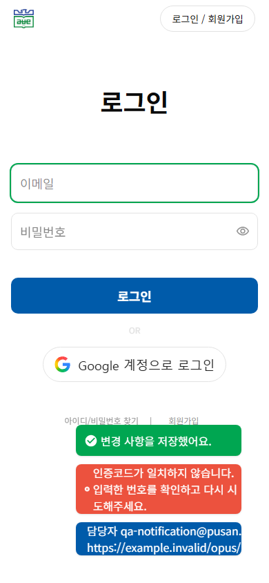
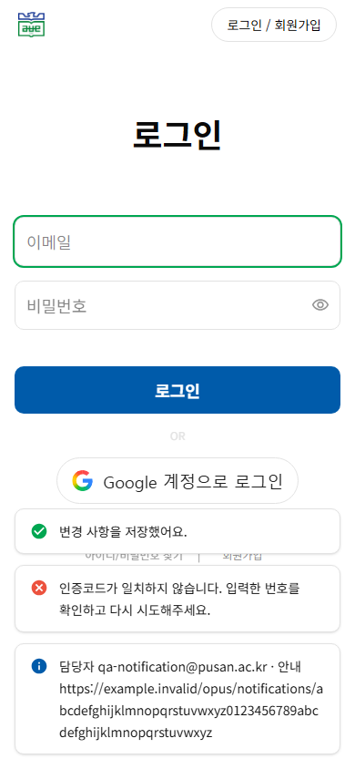
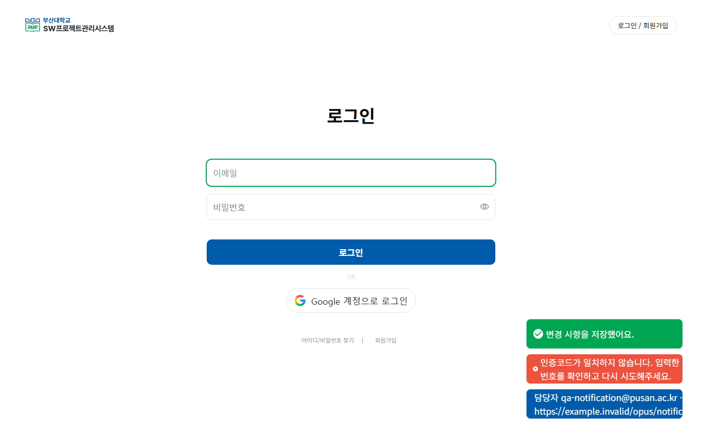
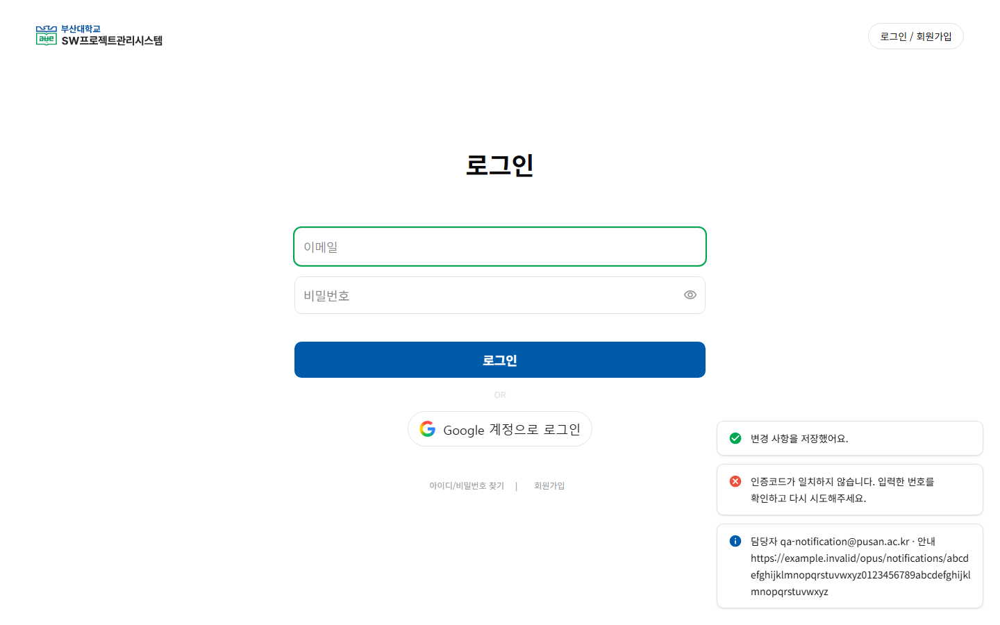

# 공통 토스트 가독성 검토 · #333

[#331](https://github.com/PNUops/opus-frontend/issues/331) 인증 화면 QA에서 발견한 한글 줄바꿈·아이콘 압축 문제를 [#333](https://github.com/PNUops/opus-frontend/issues/333)으로 분리했다. 기존 OPUS의 `mainGreen`, `mainRed`, `mainBlue`, `lightGray` 토큰과 실제 화면을 기준으로 개선했다. 확인한 Figma 메타데이터에는 토스트 전용 node가 없어 정확한 node 일치를 주장하지 않는다.

## Before / After

실제 브라우저 원본 캡처이며 합성 한글·이메일·`example.invalid` URL만 사용했다. 실제 계정이나 사용자 정보는 포함하지 않는다.

| 화면 | Before | After |
| --- | --- | --- |
| Mobile · 390×844 |  |  |
| Desktop · 1440×900 |  |  |

768×1024도 같은 합성 상태로 캡처하고 직접 검토했다. 세 크기 모두 성공·오류·정보 메시지, 긴 한글과 URL, 여러 토스트를 확인했다.

## 관측과 보완

| 항목 | Before | After |
| --- | --- | --- |
| 성공 / 오류 본문 대비 | 3.19:1 / 3.59:1 | 모두 17.93:1 |
| 긴 정보 메시지 아이콘 폭 | 0px까지 축소 | 모든 상태 20px |
| URL 내부 넘침 | Desktop·Tablet 651px / Mobile 625px | 모두 0px |
| 모바일 폭 / 좌우 여백 | 240px / 비대칭 | 358px / 16px |

흰색 바탕과 진한 일반 굵기 본문, 기존 상태색 아이콘으로 읽기와 상태 구분을 분리했다. 한글 어절은 유지하고 공간에 들어가지 않는 긴 URL·이메일만 추가 줄바꿈하며, 아이콘은 첫 줄에 고정 정렬한다.

Before와 최종 After 이미지를 모두 직접 열어 비교했다. 첫 개선안에서 긴 URL을 포함한 토스트 3개가 모바일 Google 로그인 버튼 하단에 조금 겹쳐, 세로 패딩을 16→12px로 줄이고 세 크기를 다시 촬영했다. 최종 샘플에서는 해당 버튼 아래에 배치된다. 많은 메시지가 동시에 표시되면 다른 콘텐츠와 겹칠 수 있으므로, 비대화형 알림 영역은 포인터 입력을 가로채지 않고 기존 입력 포커스를 유지한다.

## 동작과 검증 범위

표시 순서·메시지 API·스토어는 유지했다. 가상 시계에서 2999ms까지 메시지가 남고 3000ms에 제거되는 것을 확인했다. 기존 CSS 애니메이션 수명도 변경하지 않았다. 세 크기 모두 한글 폰트 로드, 가로 넘침 0, 처리되지 않은 JavaScript 오류 0을 확인했다.

지속적으로 마운트되는 `role="status"` 영역에 `aria-live="polite"`, 추가 항목 안내를 적용하고, 상태 이름은 보조기기에 전달하며 장식 아이콘은 숨겼다. Chromium의 접근성 속성과 DOM을 확인했으며 **실제 NVDA·VoiceOver 음성 전달은 미검증**이다.

별도 검토에서 보통 길이와 540자 메시지를 연달아 넣어 각 내용이 접근성 트리에 한 번씩만 존재하고, 기존 알림 DOM·입력 포커스·표시 순서가 유지됨을 확인했다. 매우 긴 메시지도 자르지 않으므로 잠시 화면을 넓게 덮을 수 있다. 메시지 길이 제한이나 표시 시간 정책은 이 변경에서 새로 정하지 않았다.

검증은 아직 `develop`에 병합되지 않은 [#314](https://github.com/PNUops/opus-frontend/pull/314)의 준비된 checkout에서 기존 Playwright·네트워크 차단·한글 폰트 검증 도구를 재사용했다. 이 브랜치에 별도 검증 프레임워크를 추가하지 않았다. 외부 API는 차단하고 로컬 MSW 환경만 사용했다.
