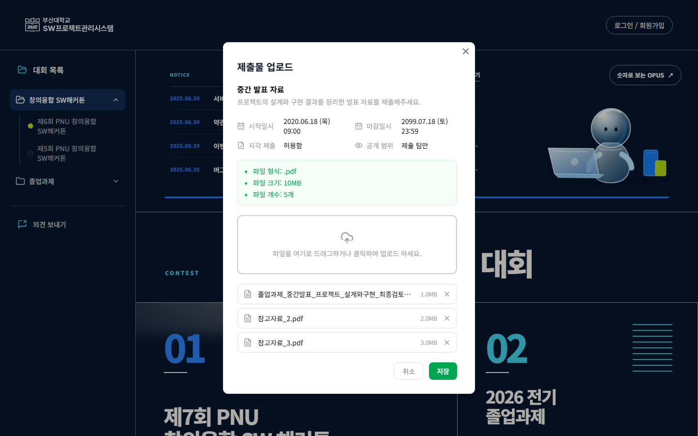
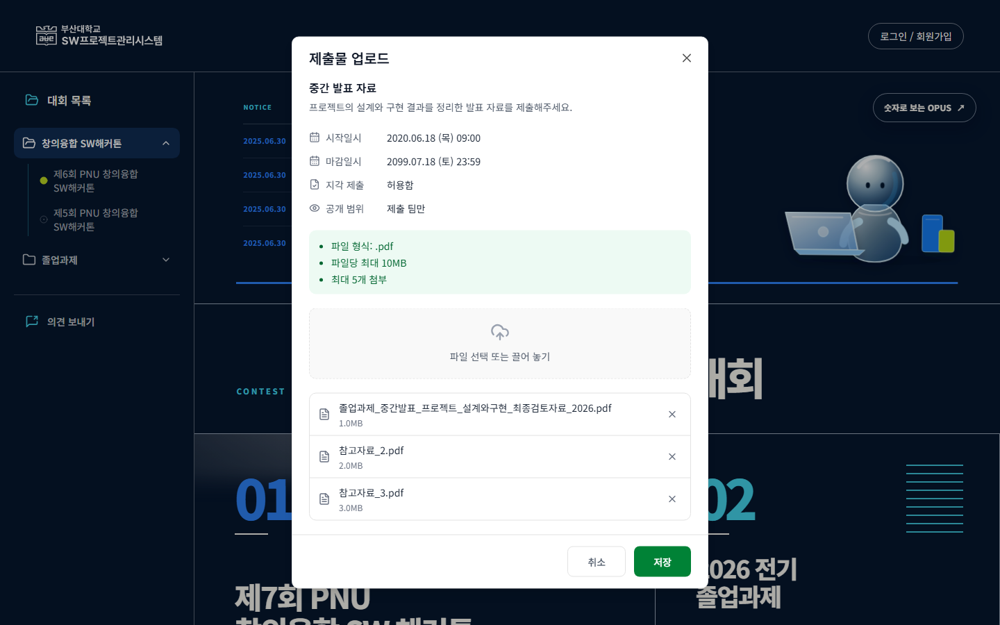
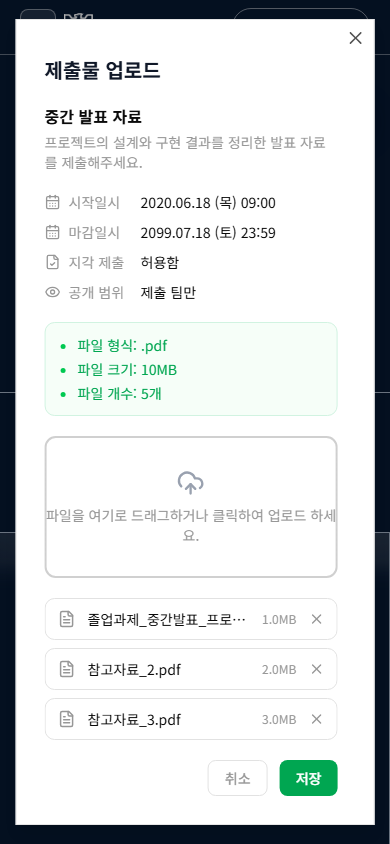
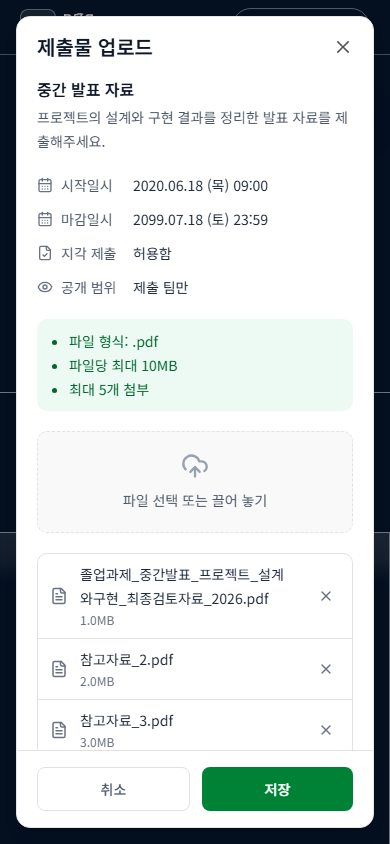
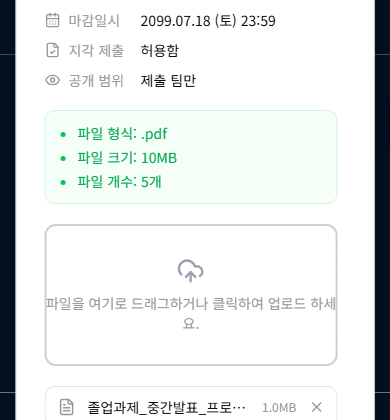
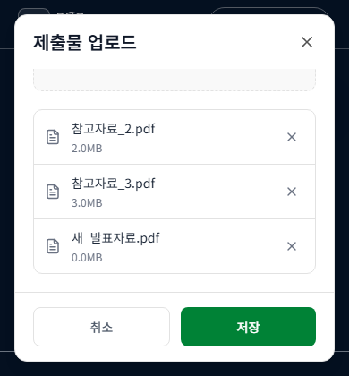
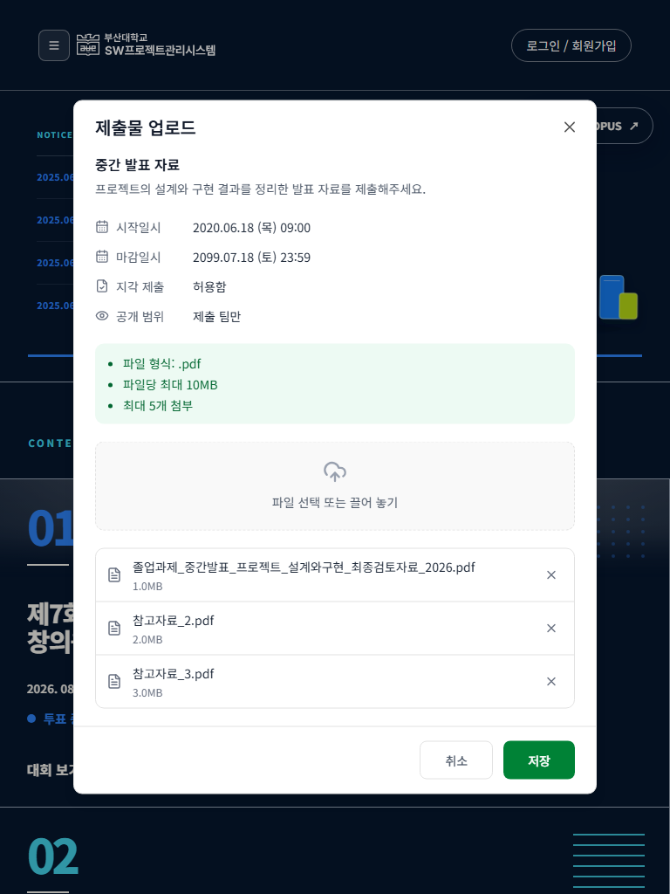
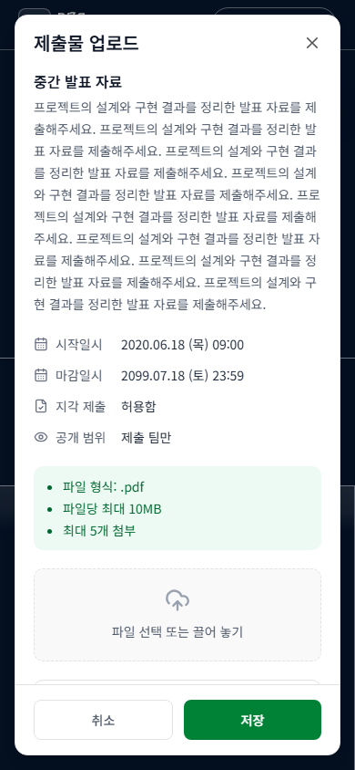
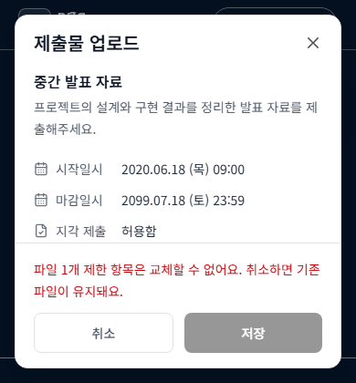
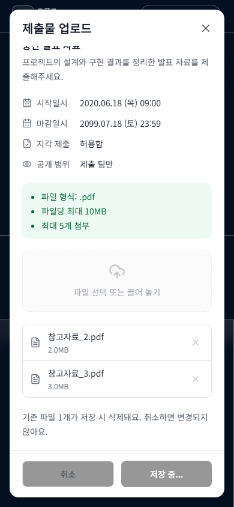

# 제출 업로드 모달 화면 검토

2026-10-30, develop `0fd079e` 기반. #343은 #309의 브라우저 검증에서 발견한 화면 결함을 분리한 작업이다. #309의 서버 계약 잔여를 해결한 것으로 간주하지 않는다.

## 문제와 설계

기존 모달은 높이 제한이 없어 390×420에서 상단이 -193px, 저장 버튼 하단이 584px에 위치했다. 제목·닫기·저장·취소가 화면 밖에 있었다. 데스크톱 날짜는 좁은 두 열에서 줄바꿈되고 긴 파일명은 생략됐다.

- [Renewal의 정확한 업로드 모달 326:2185](https://www.figma.com/design/HbyxwchvTkzD4pbtdjCHkg?node-id=326-2185)의 정보 순서와 한 열 날짜 배치를 참고했다. 기존 OPUS 실화면·Noto Sans KR·녹색/중립색 토큰 및 Dialog, AdminActionButton, Lucide를 재사용했다. 전체 디자인을 픽셀 단위로 복제한 것은 아니다.
- 16px viewport 여백과 `100dvh` 최대 높이를 두고 본문만 스크롤한다. 파일 목록 내부의 중첩 스크롤을 없앴다. 제목·닫기와 저장 제한 사유·액션은 계속 보인다. 긴 파일 편집 폼이므로 바텀 시트로 바꾸지 않았다.
- 긴 파일명은 읽을 수 있게 줄바꿈하고 크기는 보조 정보로 분리했다. 삭제·닫기·액션은 44px이며 삭제 버튼 이름에 파일명을 포함한다. 보조 설명·경고의 대비를 높이고 주 액션에는 기존 녹색 계열의 진한 단계를 사용했다.
- 최초 자동 포커스를 제목으로 옮겼다. 파일 선택 버튼에 포커스되면서 긴 설명의 시작이 가려지는 현상을 재캡처에서 확인해 보완했다.
- 저장 오케스트레이션·API·Query 무효화와 기존 안전 장치는 그대로 사용한다. 이 화면 수정에 새로운 전역 상태나 UI 프레임워크는 필요하지 않았다.

## 실제 검토와 결과

기존 #314 checkout(`545203c4`)의 Playwright/Chromium 및 외부 통신 차단을 재사용했다. 별도 production 컴포넌트를 복제하지 않고 실제 `SubmissionUploadModal`, Dialog, Query client, API wrapper를 브라우저에 마운트했다. 부모의 열기/닫기 조건은 작은 QA wrapper가 제공하고 서버 파일 상태는 MSW 합성 데이터다. 공개 홈은 배경이며 실제 학생 경로의 역할 가드·페이지 통합 검증을 의미하지 않는다.

| 검토 | 기록 |
| --- | --- |
| 변경 전 1440/768/390, 높이420 | 6장, [before.json](before.json). 화면 밖 액션 재현 |
| 수정 후 3개 너비·낮은 높이·저장 상태 | 27장 / 18개 시나리오 그룹, [final.json](final.json), 실패·문서 가로 넘침 0 |
| 긴 설명의 글꼴 로딩·초기 포커스 | [font-check.json](font-check.json), 본문 scrollTop=0, 제목 H3 포커스, 제출 항목 시작 y=77 |
| 1개 교체·마지막 삭제의 제한 안내 | 추가 4장, [blocked-short.json](blocked-short.json), [last-short.json](last-short.json). 높이420에서도 안내·액션 노출 |

이미지를 직접 검토해 날짜 정렬, 파일 식별, 간격·대비, 긴 설명, 삭제 예정·저장 중·재조회 결과를 확인했다. 모바일 기본 모달은 y=16~828, 390×420에서는 y=16~404이고 저장 버튼도 viewport 안에 있다. 원본 PNG 10장을 아래에 남겼다.

취소/X/Escape/바깥 클릭 후 서버 요청 0과 초안 초기화, 삭제만 저장, 추가만 저장, 여유 공간에서 업로드→삭제, 개수 제한에서 필요한 삭제→업로드, 부분 실패 후 실제 상세 Query 재조회·초안 폐기를 확인했다. 저장 응답을 명시적으로 보류해 닫기·중복 요청 보호를 확인했으며, 최초 700ms 지연만 둔 검사에서 발생한 타이밍 문제는 이 방식으로 제거했다. 키보드 Tab이 모달 안에 머무는 것도 검증했다. 기존 제출 단위 테스트 15개, TypeScript/빌드 및 lint(오류0, 기존 경고5)를 확인했다. 빌드의 기존 큰 청크 경고는 별도 성능 PR #337 범위다.

## 남은 범위

- #314는 아직 Draft·미병합이다. 준비된 기반을 재사용했으며 develop의 최종 통합·전체 PR 조합은 별도 확인이 필요하다.
- #309 / [BE #239](https://github.com/PNUops/opus-backend/issues/239)의 원자적 파일 수정·마지막 파일 삭제·최대1개 교체 계약은 미확정이다. 현재 차단과 기존 파일 보존을 유지한다.
- 실제 백엔드/파일·실계정, 부모 페이지의 권한, 실기기 가상 키보드·스크린리더 음성은 이 기록에서 검증하지 않았다. 390×420은 낮은 viewport 시험이다.
- [10/12 회의](https://app.notion.com/p/3f9b174e8df681d8ab46fb75f2908443)의 팀 구성 잠금·행정 정책은 변경하지 않는다.

## 캡처

| 데스크톱 이전 | 개선 |
| --- | --- |
|  |  |

| 모바일 이전 | 개선 |
| --- | --- |
|  |  |

| 낮은 높이 이전 | 파일 목록 스크롤 후 |
| --- | --- |
|  |  |

[실행 환경과 QA wrapper 원문](scenarios.md)
